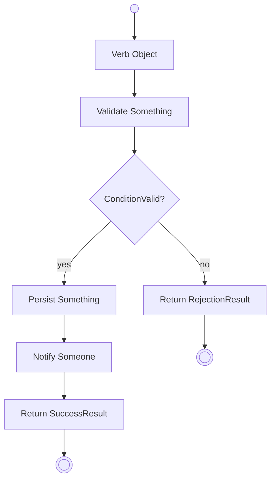

# Review Business-Process BPMN (against the interview transcript)

A human has drawn a BPMN for one business process. It may be invalid (broken XML, missing
shapes) or merely incomplete. Your job is to review and correct it against the **interview
transcript**, identify the **System Interactions**, and emit the complete, consistent artifact
set for that process.

**Source of truth — provenance chain.** The **raw interview transcript is the single source of
truth.** Everything else is a *derivative* that must stay faithful to it and reconcilable back to
it: the distilled **notes** `.md` (from the `process-interview-transcripts` skill), then the
**BPMNs**, the **SI activity diagrams**, and the **BP/SI developer markdowns**. The notes are a
convenient distilled index — **not** an authority: when the notes and the transcript disagree, the
transcript wins and you fix the notes. The developer markdowns *do* become the day-to-day
*implementation* source of truth for developers, but they are derivatives too — never let them
drift from the transcript. If you only have a raw transcript, distill it first with
`process-interview-transcripts`, then run this skill.

**No transcript? Stop and ask.** If there is no transcript in the directory, do **not** silently
proceed — explicitly ask the user, e.g. *"There's no transcript here — do you want to continue
using the BPMN as the source of truth?"*, in case they simply forgot to drop it in the folder. Only
on their confirmation do you proceed with the **BPMN as a *provisional* source of truth**; then flag
every detail you had to infer (there was no transcript to ground it) as a Q&A entry, and keep
nudging for the transcript so the derivatives can be re-grounded later. (If distilled notes exist
but the transcript doesn't, treat the notes as the best available record — but still flag the
missing transcript.)

## When to use

- The user asks to review / validate / correct / complete a business-process BPMN.
- The user asks to derive a "level 2" (`02_detailed`) BPMN, or to identify / number the system interactions.
- The user asks to (re)generate the BP diagrams and the BP markdown.

## Know which level you are holding — this is critical

There are two detailed levels of every business-process BPMN. **Both keep every step** — the
difference is only how the System Interactions are rendered. **Before you change anything, decide
which one the input is.**

- **Level 1 (`01_detailed`) — fully detailed, no SIs identified yet.** Every single step the
  stakeholder described is its own box, in every lane (Customer, Back office, Provider, *and* the
  System). Nothing is combined and no System Interactions are identified yet. This is the faithful,
  granular transcription of the interview.
- **Level 2 (`02_detailed`) — the same detailed steps, with each System Interaction wrapped as a
  collapsed sub-process.** Keep *every* detailed step from level 1; the only change is that each
  **System Interaction**'s system-pool steps are wrapped in a **collapsed sub-process**
  (`<bpmn:subProcess>` with `isExpanded="false"`) labelled with the minted SI id
  `SIxx.yy_<Name>`. The detail is **not** dropped — it is kept *inside* the sub-process and
  stays expandable. One SI = one operation call into the system, i.e. think *one API call*. The
  human/external lanes stay granular and unwrapped; only each SI's system-pool steps are folded into
  its collapsed sub-process.

A **System Interaction (SI)** is only ever work performed by the **System** pool. One SI = one
operation call. Validation checks, persistence, and the notifications a call emits all belong
*inside* that single SI's sub-process — they are not separate top-level system boxes.

**Detect the level from:** the filename / folder (`*_01_detailed` vs `*_02_detailed`,
`diagrams/01_detailed/` vs `diagrams/02_detailed/`); and the content (system pool's steps grouped
into collapsed sub-processes labelled `SIxx.yy_<Name>` ⇒ level 2; flat, granular system
boxes with no SI labels ⇒ level 1). If the signals conflict or are absent, **ask the user**.

## What makes a good Business Process (where one BPMN ends and the next begins)

Before identifying SIs, check that the BPMN *is one process*. The commonest review error is a
single diagram that is really several processes stitched together — it inflates gateways,
endings, and SIs, and every downstream tier multiplies the mistake.

- **A distinct trigger is a distinct process.** A trigger is a `start` / `messageStart` /
  `timerStart` that begins a flow of its own — **not** a gateway branch inside an
  already-triggered flow. A gateway branch is an in-flight decision and stays put; a new
  trigger is a new BP.
- **One anchor, one close.** Each BP hangs on a single entity for its whole length (an order,
  a table, a customer record) and ends in one terminal outcome-family. A BPMN that both
  *takes* an order (ends confirmed / no-order) and *fulfils* it (ends paid / failed /
  cancelled) is two processes joined by a workflow seam — split it.
- **Fulfilment is downstream, not a longer tail.** Work that resumes after a seam (confirmed →
  *later* cooked → delivered → paid) is a downstream BP reached by a message/state hand-off,
  drawn as a **black-box pool**, not appended to the triggering BP. (Same principle as "waits
  and hand-offs are seams *between* use cases" below, one tier up.)
- **Boundary test:** *"Does this BPMN have more than one independent trigger whose flows never
  converge on a shared tail?"* If yes, it is probably several processes — factor them, home
  each SI at its defining BP, and let SIs shared across BPs keep their defining BP's prefix
  (they recur in each BP's overview "System Interactions" table; the id system collapses the
  recurrence at binding — `design-artifact-conventions`).
- **Prefer a correctly-factored landscape to a stripped-down one.** The remedy for an
  overloaded BPMN is splitting along trigger seams, not deleting real behaviour.

## What makes a good System Interaction (an SI **is** an IDesign Use Case)

IDesign's **Use Case** and this skill's **System Interaction** are the same concept — apply
IDesign's use-case discipline to find good SIs. (Load the `idesign-knowledge` skill for depth.)

- **One SI = one use case = one synchronous call stack.** A use case is a *single user-initiated
  interaction with the system*: one entry, one orchestration, one session boundary, returning to
  the caller within that single request/response. In BPMN terms, **every message that arrives into
  the System pool triggers exactly one SI** — the system does its synchronous work and returns;
  the next inbound message is the next SI.
- **A use case starts at a Manager.** The one public operation the actor invokes is a Manager
  operation that *orchestrates* a downward call stack (Manager → Engine / ResourceAccess →
  Resource) — orchestration plus data-contract transformation only; business logic in the Manager
  is a smell (it belongs in an Engine). You don't draw those layers (see the activity-diagram
  rules), but that single Manager call *is* the SI's boundary.
- **The business process is a *workflow*; each SI is a *use case* within it.** A workflow is a
  sequence of use cases across time/sessions — emergent, never a thing you build. That is exactly
  the BP ↔ SI relationship. The waits and hand-offs in the BPMN (the customer goes away, the back
  office phones the provider) are workflow seams *between* use cases — never part of any one SI.
- **Granularity test:** *"If I listed the use cases from scratch from the interview, would I list
  this as one business operation the actor can invoke?"*
  - Reads like a multi-step story spanning several round-trips → it's a **workflow in disguise;
    split** it (one SI per round-trip / inbound call).
  - Two adjacent system boxes that are really internal steps of one call (validate + persist +
    notify) → **collapse** into one SI; the steps become its internal activities.
- **Name SIs as behavioural business verbs** — `VerbObject` (`RequestMaintenanceSlots`, `BookSlot`,
  `CreditAccount`). Never CRUD or property-like names (`Create/Update/Delete`, `Get*`, `Set*`);
  prefer `Edit` for low-volatility UI use cases. Every SI maps 1:1 to a business use case the actor
  performs; a box that isn't such a use case is internal orchestration (collapse it), not its own SI.
- **Permutations are the SI's alternative paths.** A permutation is an alternative path through one
  use case (happy path, rejection, expiry, not-found). Model one only where it *materially* changes
  the outcome — it becomes a branch in the activity diagram and the matching gateway in the
  level-2 (`02_detailed`) BPMN. Several variants of the same verb (same return type, same postconditions) are
  polymorphism on one SI, not several SIs.
- **Each SI has a success boundary (acceptance criterion) and owns its data** — its request /
  result DTOs reflect the use case, not storage tables, and are never shared with another SI.
- **Prefer symmetry and small numbers.** Good use-case sets repeat shapes (if 3 of 4 SIs emit an
  event and the 4th doesn't, question it); one business process yields a handful of SIs, not dozens.

> **Downstream (full rules: the `design-artifact-conventions` skill).** During system design the
> SI **binds** to a facet·operation — a record in the model and the binding map, **not** a rename:
> the id you mint here is the id the code carries (ADR-066). The SI `SIxx.yy` → model use case;
> each variation the operation turns out to have →
> a permutation `zz` with its own `SQxx.yy.zz` sequence, while the architect derives the one `CCxx.yy`
> call chain (1:1 with the SI). The SI names the operation, not a variation. Keep the behavioural verb stable once
> assigned; load `design-artifact-conventions` for the id system and the docs↔model↔code mapping.

## What you always produce (all five)

Regardless of which level you were handed, the review yields **both** BPMNs plus the
diagrams and the markdowns:

1. A corrected **level-1 (`01_detailed`)** BPMN — one box per stakeholder step; no SIs identified yet.
2. A derived **level-2 (`02_detailed`)** BPMN — the same detailed steps, each System Interaction's
   system-pool steps wrapped as a collapsed sub-process (detail preserved inside).
3. **One Mermaid activity diagram per System Interaction**, embedded as a ` ```mermaid ` fence in
   that SI's developer markdown (identical canonical format for all; ADR-053 — no separate diagram
   file, no generated SVG).
4. **One developer markdown per System Interaction** (`SIxx.yy_<Name>.md`).
5. **One per-process overview markdown** (`BP<#>_<Name>.md`).

Each `.bpmn` is also **rendered to an SVG** (skill `render-bpmn-to-svg` from the `bpmn-tools`
plugin) into `SVG/`, so the markdown `![…]` links resolve. The SI activity diagrams need no
rendering step — Mermaid fences render wherever the markdown is viewed (ADR-053).

(Given a level-2 input, still reconstruct/verify level 1 by reading the steps back out of each SI's
collapsed sub-process and checking them against the transcript — then re-derive a clean level 2.)

## Output locations — under `docs/02_Business/`

| Artifact | Path (relative to `02_Business/`) |
|----------|----------------------------------|
| Corrected level-1 (`01_detailed`) BPMN | `01_Business-Processes/diagrams/01_detailed/BP<#>_<Name>.bpmn` |
| Level-2 (`02_detailed`) BPMN | `01_Business-Processes/diagrams/02_detailed/BP<#>_<Name>.bpmn` |
| Per-process overview markdown | `01_Business-Processes/BP<#>_<Name>.md` |
| SI developer markdown (one per SI, activity diagram embedded — ADR-053) | `02_System-Interactions/BP<#>_<Name>/SIxx.yy_<Name>.md` |
| BP diagram SVG, level 1 (rendered) | `01_Business-Processes/SVG/BP<#>_<Name>.01_detailed.svg` |
| BP diagram SVG, level 2 (rendered) | `01_Business-Processes/SVG/BP<#>_<Name>.02_detailed.svg` |

Business-process artifacts live under `01_Business-Processes/`; System-Interaction artifacts under
`02_System-Interactions/`, **grouped one sub-folder per business process**
(`02_System-Interactions/BP<#>_<Name>/`) — each holds that process's `SIxx.yy.*` `.md` files
(activity diagram embedded, ADR-053)
(e.g. BP02's SIs sit in `02_System-Interactions/BP02_EnrollInMaintenancePlan/`). Render
each `.bpmn` to SVG with the **`render-bpmn-to-svg`** skill (from the `bpmn-tools` plugin) into
`01_Business-Processes/SVG/` so the `![…]` image links in the BP markdowns resolve; SI diagrams
are Mermaid fences and need no rendering (ADR-053).

The level lives in the SVG's **file name**, not in a sub-folder: `-o
01_Business-Processes/SVG/BP<#>_<Name>.01_detailed.svg` and `…02_detailed.svg`, which is the
renderer's own canonical embed path (`render-bpmn-to-svg` SKILL.md). The Design Book reads exactly
those two names per process (#1057), so a project that nests the second level in a sub-folder
instead cannot build its book.

Never delete or overwrite the source transcript. If the project keeps a working copy of a BPMN
(e.g. under `01_Planning/.../mini-folder/`), keep it byte-identical to the canonical copy.

## Procedure

1. **Load the source of truth.** Read the **raw transcript** for this process (the authority).
   **Ensure it has been cleaned up first:** if a transcript exists but has not yet been distilled
   into notes, run the **`process-interview-transcripts`** skill now to clean it up, then continue —
   this skill works from the distilled notes as its index. Read those notes, but treat them as a
   derivative — verify them against the transcript and re-distill / fix them if they diverge (or if
   the transcript is newer than the notes). **If no transcript is present, stop and ask the user** before
   proceeding (see *Source of truth* — they may have just forgotten to add it). Identify the BP
   number and name (e.g. `BP03 — Schedule Maintenance Job`).
2. **Locate the input BPMN(s) and detect each one's level** (see above). Stop and ask if
   ambiguous.
3. **Review for validity.** Parse the BPMN and fix: malformed XML; sequence/message flows whose
   `sourceRef`/`targetRef` do not resolve; flow nodes, flows, or participants missing a
   `BPMNShape`/`BPMNEdge` (DI); pools missing the lanes the notes require; missing start/end
   events; gateways with fewer than two outgoing flows; message flows that do not cross pools.
4. **Review for completeness & correctness against the transcript.** Every step, actor/lane,
   validation rule, decision, and edge case the stakeholder described (in the transcript — use the
   notes only as a quick index) must appear in the model — or be recorded as an open question. Step
   order, gateway conditions, and message flows must match the described flow.
5. **Produce the corrected level-1 (`01_detailed`) BPMN** — every stakeholder step is its own box,
   in every lane including the System. Nothing combined; no SIs identified yet.
6. **Derive the level-2 (`02_detailed`) BPMN** — keep every detailed step, but wrap each System
   Interaction's **system-pool** steps in a collapsed sub-process (apply the discipline below). Leave
   the human/external lanes granular.
7. **Identify & MINT the System Interactions' ids** — **`SIxx.yy`** (ADR-030 §3 as amended by
   ADR-066): globally unique across the whole project, carrying no facet meaning and no business-
   process meaning — take the next free number with the whole `.bpd` set in view (the Sequence
   Map's `operations` keys are the inventory). **This is the id the code will carry**: it is
   minted once, here, and never renamed. System design later records which facet·operation it
   resolves to; that is a binding, not a rename. The operation's variations become permutations
   then, numbered on the `SQ` sequences, not the SI.
8. **Author each SI's Mermaid activity diagram** (canonical format below) directly in the
   `## Diagram` section of that SI's developer markdown.
9. **Render the BPMNs to SVG** — every `.bpmn` via the `render-bpmn-to-svg` skill (from the
   `bpmn-tools` plugin), into the `SVG/` folder the markdowns reference.
10. **Write one developer markdown per SI** (`SIxx.yy_<Name>.md`) and **one overview markdown for
   the process** (`BP<#>_<Name>.md`) — golden templates below.
11. **Sweep the project's markdowns for consistency** and fix the obvious inconsistencies.
12. **Validate everything** (final checklist) before reporting.

## Level-2 (`02_detailed`) system-interaction discipline

Level 2 does **not** discard the detailed system steps. It keeps them and wraps each SI's
system-pool steps into a **collapsed sub-process** (`<bpmn:subProcess>` with `isExpanded="false"`),
so the detail stays inside the sub-process (expandable) instead of being flattened into a lossy bare
box. The discipline for *what* a single SI is — its boundary — is unchanged:

- **Each inbound call into the System pool is one SI** — one use case = one synchronous call
  stack (see *What makes a good System Interaction*). The waits between inbound calls are workflow
  seams, not SIs.
- The **System pool contains nothing but SI sub-processes** (plus the control-flow gateways that
  branch on their results). No bare top-level system tasks, no free-floating decision boxes — every
  system step lives *inside* the collapsed sub-process of the SI it belongs to.
- **Each SI is one collapsed sub-process** labelled `SIxx.yy_<Name>`, with that SI's detailed
  system steps (validate, persist, notify, return) kept inside it. Collapsed (`isExpanded="false"`)
  so the BP overview stays readable; the steps remain available by expanding it.
- An **exclusive gateway is pure control flow**: it only *branches on the result an SI returns*
  (e.g. "Active plan? (BP03-SI01.01 result)"). The check itself lives inside the SI sub-process.
- An **SI emits the messages it produces.** Notifications to other pools are message flows that
  originate from the SI sub-process, not from extra "notify" tasks.
- **One SI = one operation call.** If two adjacent system boxes are really one call (validate +
  persist + notify), they are the internal steps of one SI sub-process. If a single drawn box is
  really two separate calls into the system, split it into two SI sub-processes.
- **Numbering:** tag each SI sub-process with its **minted `SIxx.yy`** — globally unique,
  zero-padded, meaning-free. The full id system — why the id carries no facet, how the
  facet·operation is recorded as a *binding* at system design (the operation's variations become
  permutations on the `SQ` sequences, not the SI) — is defined canonically in the
  **`design-artifact-conventions`** skill; load it. On revision, **never renumber**: an unchanged
  SI keeps its id, a new one takes the next free number, and a removed one's id is retired and
  never reused (ADR-066).
- The per-SI `.md` developer specs (with their embedded activity diagrams) are still **derived from
  these SIs** — one per SI sub-process, using the same id and name (see below).

## BPMN authoring notes (so the file actually renders)

- Keep the collaboration (participants + message flows), one `<bpmn:process>` per pool, then the
  `<bpmndi:BPMNDiagram>`. Every flow node, sequence flow, message flow, and participant needs a
  matching DI shape/edge, or it will not display.
- The Maintenance Provider (or any off-system actor reached by phone/email) is a **black-box
  pool**: no internal flow elements; message flows connect to the participant boundary.
- After writing, validate well-formedness and that every flow `sourceRef`/`targetRef` resolves
  and every element has DI (a short Python `xml.etree` pass is enough).
- The `bpmn-tools` skill can **build** a pool-based BPMN from a small coordinate-free JSON spec
  (it generates the DI layout) and **validate** an existing one — use it to author level 1
  (`01_detailed`) from the notes and to lint both detailed levels before rendering. It now also
  supports a **`subProcess` step type** — a step carrying its own nested `{steps, flows}`, rendered
  as a **collapsed sub-process** — which is how you author the level-2 (`02_detailed`) BPMN: one
  `subProcess` step per SI, labelled `SIxx.yy_<Name>`, holding that SI's detailed steps.

## SI activity-diagram format (Mermaid, ADR-053) — identical for every SI

Lives in the SI markdown's `## Diagram` section as a fence:

````

````

Conventions: activity labels are `"Verb Object"` in PascalCase words; decision labels are
PascalCase ending in `?`; branch edges carry the outcome label (`-- yes -->` / `-- no -->`);
the start node is `S(( ))`, and every branch ends in a `"Return …"` activity with its **own**
end node `E#((( )))`. The SI's internal validation and notifications (the steps inside its
collapsed level-2 sub-process) belong here.

**Model one use case as a single flat flow — no lanes, no pools.** The activity diagram is
deliberately *layer-agnostic*: do **not** split it into subgraphs for Client / Manager / Engine /
ResourceAccess, and do not separate by subsystem or component — which layer performs each step is a
detailed-design decision made later, not here. The surrounding markdown heading names the diagram;
never introduce Mermaid `subgraph` lanes.

The diagram shows the SI's one synchronous call stack as logical activities — validate, retrieve /
compute, persist, notify, return — and its **permutations** as `if/else` branches. Keep it *chunky,
not chatty* (aggregate retrievals into one step), keep words minimal (a clean diagram passes
"Absorb, Adopt, Advocate"), and end every branch in an explicit `:Return\n…;` outcome with its own
`stop`. The branch set must match the SI's permutations and the level-2 (`02_detailed`) gateway that
reads this SI's result.

> **This layer-agnostic activity diagram is what the architect later resolves into the call chain**
> (`03_Technology/02_Call-Chains/`) — one sequence diagram per SI, with each activity step mapped to
> a concrete downward call through the component layers under the IDesign layering laws. The sequence
> is therefore *derived* from this diagram, not invented (ADR-030).

## Developer markdown — what to implement and how

Two markdowns carry the implementation detail the diagrams cannot. Both are **lean and
table-driven** — developers scan them. Match the structure the two sections below specify:
`SIxx.yy_<Name>.md` per System Interaction and `BPxx_<Name>.md` per business process.

**The filename shapes below are the live ones and there is no compatibility spelling.** This
paragraph used to cite two worked examples named `BP01-SI01.01_CreateLogin.md` and
`BP02_EnrollInMaintenancePlan.v2.md`. Neither file exists in this repository, and the first
carries the `BPxx-SIaa.bb` form that ADR-066 §1 retires outright — a System Interaction's id is
minted once at Mockup and never rewritten, and `design-artifact-conventions` rule 5 says a `BP`
prefix is not an id at all. A project that followed the old sentence created exactly the
filenames `seqmap si-docs` then refuses with `[D1]` (#1359).

### Per-System-Interaction spec — one `SIxx.yy_<Name>.md` per SI

The developer contract for one use case:

- `# SIxx.yy_<Name>`
- `## Description` — one paragraph: what the SI does end to end (validate → … → return).
- `## Workflow Context` — a `| Direction | Data |` table with two rows: **Reads from context**
  (what earlier SIs left for it; `— (first SI in flow)` if none) and **Stores to context** (what
  this SI contributes for later SIs). This makes the inter-SI data flow explicit.
- `## Diagram` — the SI's Mermaid activity diagram as a ` ```mermaid ` fence (canonical format
  above; single source, renders in place — ADR-053).
- `## Steps` — the implementation table, one row per internal activity:
  `| # | Operation | Input | Output | Notes |`. Operation = behavioural verb; Input / Output =
  the DTO fields; Notes = validation, branch/error behaviour, side effects. This is where the
  activity diagram's permutations get their concrete data and rules — the real "how to build it".
- `## Used in` — `| Business Process | Task Name |`, linking each BPMN that invokes this SI. (The
  SI doc lives in `02_System-Interactions/BP<#>_<Name>/`, so its BP links read
  `../../01_Business-Processes/BP<#>_<Name>.md` and its diagram image `../SVG/SIxx.yy_<Name>.svg`.)
- `## Q&A` — `| # | Question | Answer | Status |` (Open / Resolved). Every gap the transcript left
  open lands here — never as invented detail.

### Per-Business-Process overview — one `BP<#>_<Name>.md`

The map of the process:

- `# BP<#>_<Name>`
- `## Description` — one paragraph; link any variant processes. **A non-live process** (its
  `.bpd` header declares `status dissolved|retired|parked`, #1148) states it in the FIRST
  paragraph of the extractable body, using the compiler's localized headline verbatim
  (`AUFGELÖSTER PROZESS` / `DISSOLVED PROCESS`, …) — `bpmn-dsl build --check` fails
  (`STATUS-UNMARKED`) while the overview misses it, because a marker only in a blockquote
  banner is exactly what every downstream extractor walks past.
- `## Diagram` — `` then
  `Source: [diagrams/02_detailed/BP<#>_<Name>.bpmn](diagrams/02_detailed/BP<#>_<Name>.bpmn)`.
- `## Participants` — `| Pool | Description |`.
- `## System Interactions (Use Cases)` — `| Step | SI ID | Use Case Name | Description |`, each
  SI ID linking to its `SIxx.yy_<Name>.md`. (The header literally says *Use Cases* — SI = use case.)
- `## Customer Activities` — `| Activity | Description |` (the customer-pool steps).
- `## Backoffice Activities` — `| Activity | Description |` (one such section per human / external
  pool, e.g. a Maintenance-Provider section).
- `## Gateways` — `| Gateway | Type | Meaning |` (e.g. `Exclusive (XOR)` with the branch outcomes).
- `## Business Events` — `| Event | Trigger | Description |`.
- `## Related Artifacts` — bullet links (variant processes, sub-processes, the SI docs).

Keep both lean — tables over prose, behavioural-verb names, and the **same SI names/numbers
everywhere**. Render each `.bpmn` to an SVG (under `SVG/`) so the `![…]` image links resolve; the
embedded Mermaid diagrams need no render step.

## Consistency sweep across the project's markdowns

After writing, **iterate over the other markdowns in the project** — start with the siblings in the
same directory, then the linked BP/SI docs — and reconcile them. The goal: **one consistent set of
terms, names, and numbers across every document.** Check each item below and, where the fix is
**obvious, apply it directly in place**:

- **SI naming & numbering** — the same SI is named and numbered identically everywhere it appears
  (its own `.md` and embedded diagram, the BP overview's SI table, the BPMN label, the "Used in" back-links);
  no duplicates in the `SIxx.yy` set. Gaps are normal and expected — ids are minted globally and
  retired ids are never reused.
- **Terminology** — one term per concept (don't mix "Maintenance Provider" / "Provider",
  "Backoffice" / "Back office", "slot" / "timeslot"). Pick the dominant, correct term; normalise
  the rest.
- **Cross-references** — every BP ↔ SI link resolves and points at the right file; a doc's
  "Used in" and the BP's SI table agree with each other.
- **Participants / pool names** — consistent across the BPMN, the BP overview, and the SI docs.

Fix obvious inconsistencies in place and **report what you changed**. For anything **ambiguous or
possibly intentional** (a real naming decision, a genuine contradiction in the source), don't guess
— add a **Q&A** entry in the affected doc and flag it to the user.

## Faithfulness rules

- **The raw transcript is the source of truth; the notes and every diagram/markdown are
  derivatives.** Ground every step, rule, and SI in the transcript — not in the notes alone, and
  not in invention. Do not silently drop anything the stakeholder described. When a derivative
  (notes, BPMN, diagram, markdown) conflicts with the transcript, the transcript wins: fix the
  derivative, never bend the record to match a diagram.
- **No transcript ⇒ provisional truth, and only after asking.** With no transcript (and the user's
  explicit go-ahead to proceed), the BPMN is the source of truth *for now*. Add nothing beyond what
  the BPMN literally shows without marking it an open question, and keep prompting for the transcript
  so the notes and diagrams can be re-grounded once it appears.
- **Surface gaps, don't fill them.** Ambiguities become Q&A entries, not guesses.
- **Preserve specifics** — numbers ("exactly 3 slots"), thresholds, named roles, error cases.
- **Keep the two levels consistent** — every level-1 (`01_detailed`) system step must reappear
  inside exactly one level-2 (`02_detailed`) SI sub-process (nothing dropped, nothing invented); the
  embedded diagrams, the markdown SI table, and the BPMN SI labels must all use the same names
  and numbers.

## Validate before reporting

- Both BPMNs: XML well-formed; every `sourceRef`/`targetRef` resolves; every flow node, flow, and
  participant has DI; in the level-2 (`02_detailed`) BPMN the system pool contains **only**
  `SIxx.yy` collapsed sub-processes (`isExpanded="false"`, detailed steps kept inside) plus
  result-branching gateways — and every level-1 system step reappears inside exactly one of them.
- SI numbering is contiguous and flow-ordered; there is exactly **one `.md` per SI, with exactly one
  embedded activity diagram**; filenames, BPMN labels, the per-SI docs, and the BP overview's SI
  table all use the same names and numbers.
- Each per-SI markdown has its `Steps` table; the BP overview lists every SI and every pool's activities.
- Post-sweep, cross-document terminology, participant names, and SI numbers are consistent; every
  relative link resolves and every `![…]` image path resolves — or, if the render toolchain is
  unavailable, the pending SVG renders are listed for the user (not silently skipped).
