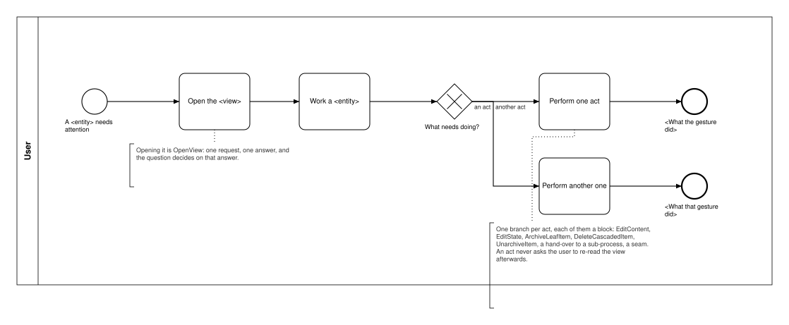
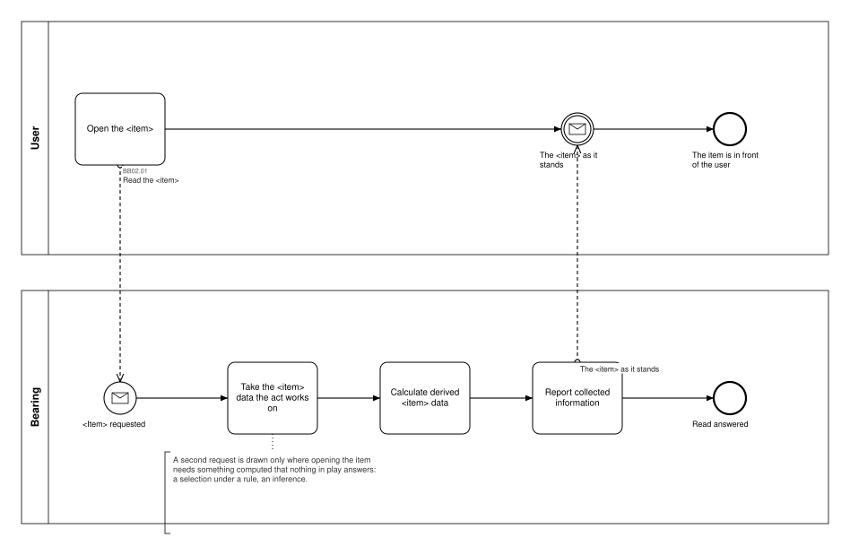
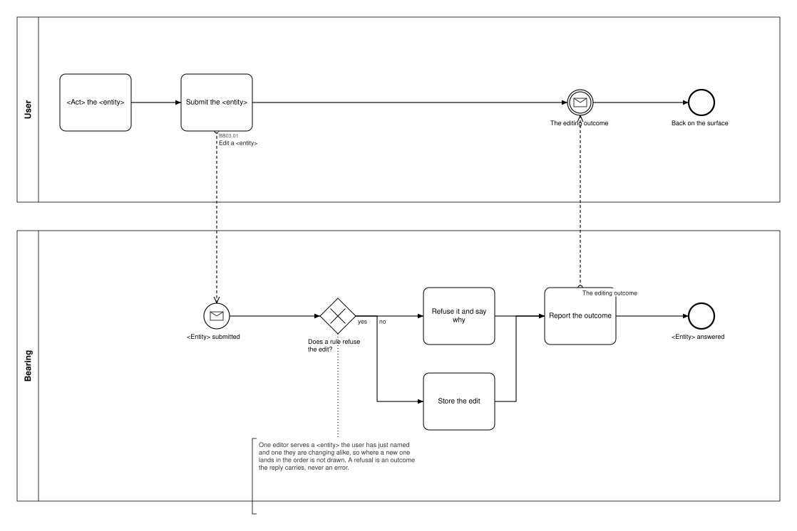
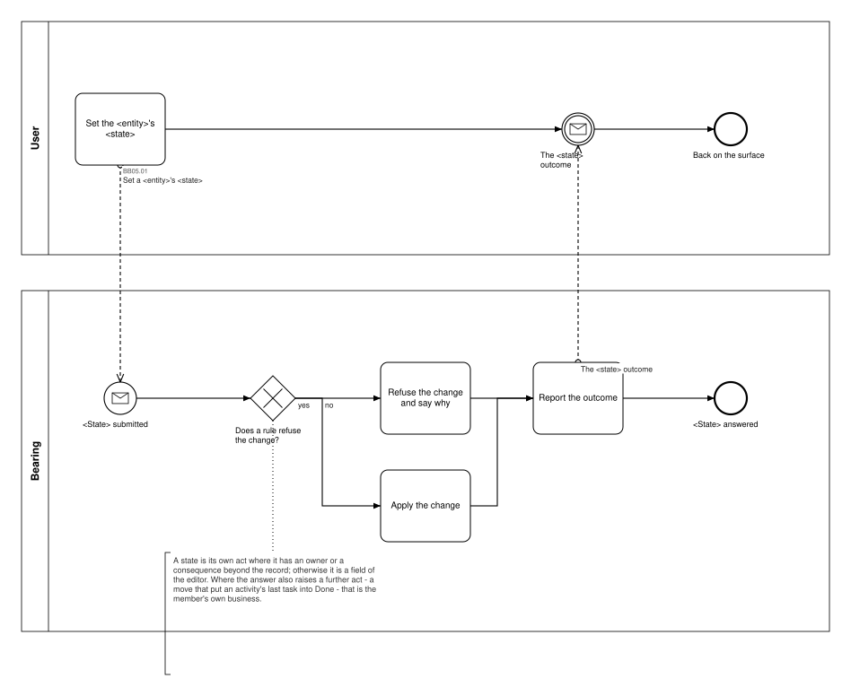
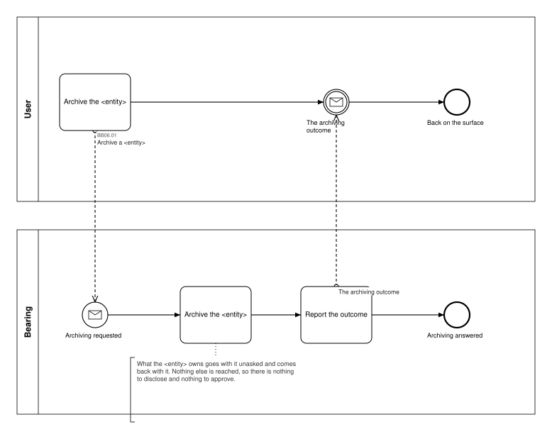
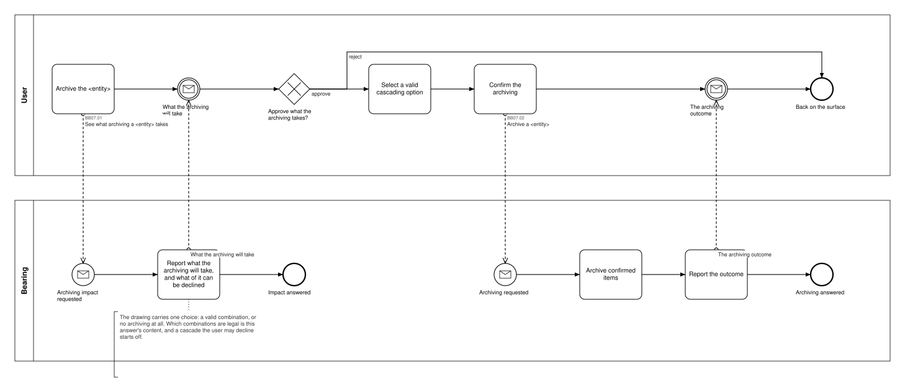
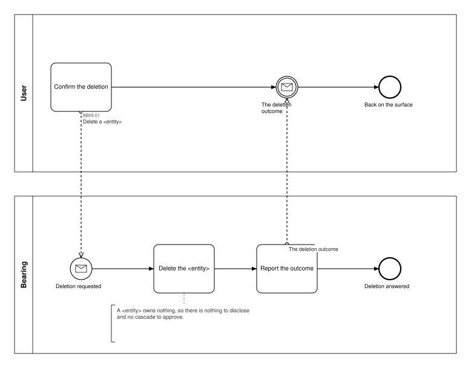
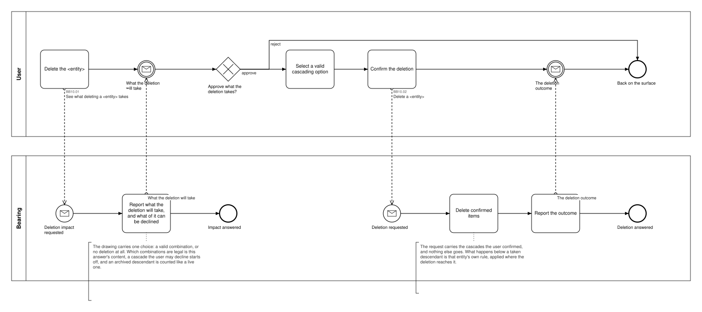
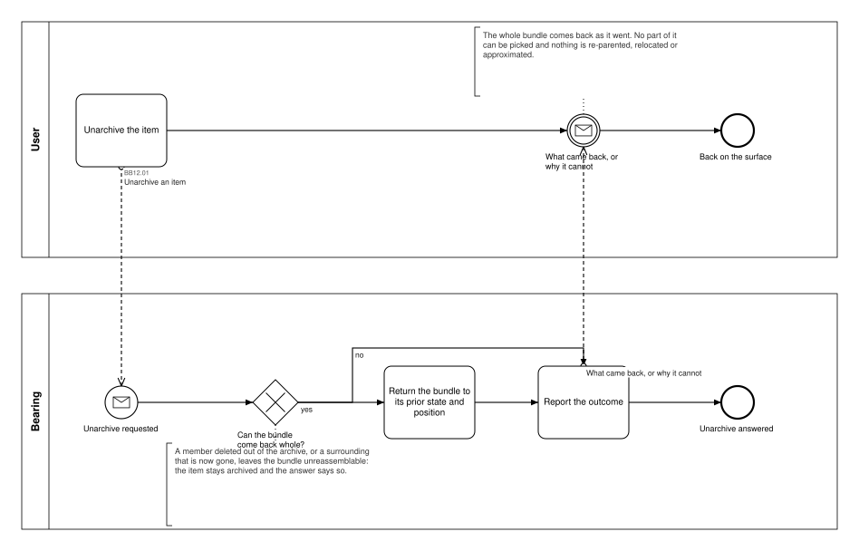
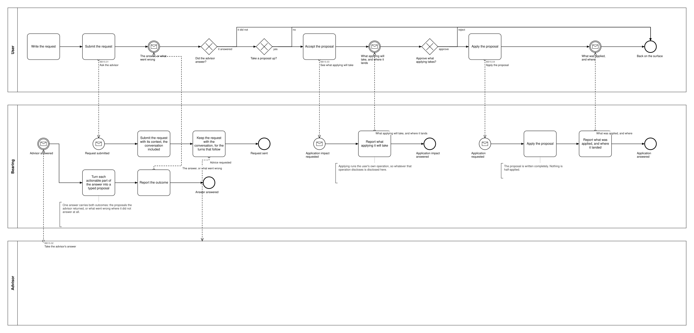

# Bearing v2 — Path patterns and the canonical building blocks

> **What this is.** The nineteen business processes draw **79 call sites**, and the paths those sit
> on are **seventeen shapes**, each named after the business activity it performs, plus the frame
> the hub processes are built on. This page names
> every shape, draws it once as a canonical building block with its own BPMN, and says which blocks
> each process is made of. A block is reviewed once; a process is then read as the blocks it
> composes. Every one of the 79 call sites falls in exactly one block, or in §4.
>
> The coarser cut — which processes are kinds of one another — is
> [`../../01_Planning/07_BP-Drawing-Patterns.md`](../../01_Planning/07_BP-Drawing-Patterns.md) (`P1`–`P8`);
> the rulings the blocks obey are [`../../01_Planning/06_Drawing-Rulings.md`](../../01_Planning/06_Drawing-Rulings.md) (`DRW-…`).
>
> **Stage.** Discovery / Mockup — before the Intent gate. Nothing here is const.
>
> **Owed: a re-review of the names.** The blocks were named after their shape until 2026-10-16,
> when the Software Architect ruled that a block is named after the business activity it performs;
> the names below are that resolution, and he asked to be reminded to re-review the set.

## 1. The blocks

A block is one **path**: the act that starts it, the request it sends, the answer it gets, and where
it leaves the user. The frame those paths hang off is a block of its own — `BB22` — so
no act block redraws it. A block's number is append-only and is not a position: `BB22` is the frame
and reads first.
`BB01`–`BB22` are drawn in `blocks/`, with `<entity>`, `<view>`, `<item>` and `<state>` as the
placeholders a member fills in. `BB16`–`BB21` are whole processes with one or two members, so the
canonical drawing is that process's own and nothing is redrawn. A block merged into another or
dropped leaves its number behind, and the number is never reused — `BB04`, `BB08`, `BB11`, `BB13`
and `BB14` are gone that way.

| Block | Activity | The shape | Paths | What a member may vary |
|---|---|---|---|---|
| [BB22](#bb22--workloop) | WorkLoop | The frame: the trigger, the opening read, the surface in front of the user, one question, and one path per act | 13 processes | The vocabulary, how many branches, and whether the end names what the gesture did (DRW-24) |
| ~~[BB01](#bb01--openview)~~ | OpenView | **Retired 2026-10-17** — a surface's content is loaded and derived at start-up, so no process draws a page read | 0 | — |
| [BB02](#bb02--openitem) | OpenItem | A second read, for what the view's own read does not carry | 4 | Which item; whether the gesture it opens is another process's |
| [BB03](#bb03--editcontent) | EditContent | Editor, submit, one request — one editor serving a new item and a changed one alike; the chain refuses and says why where a rule forbids it, and the answer names the outcome | 14 | Which fields; which rule can refuse; the act's own word, which is never *edit* |
| [BB05](#bb05--editstate) | EditState | EditContent's chain with another verb in the box: one gesture that carries its own value — a flag, a position, a placement — attempted rather than assumed | 11 | Which state; which rule can refuse; whether the answer also raises a further act |
| [BB06](#bb06--archiveleafitem) | ArchiveLeafItem | No disclosure, no approval, no confirmation: archiving is reversible and reaches nothing. The answer names the outcome | 3 | Which entity |
| [BB07](#bb07--archivecascadeditem) | ArchiveCascadedItem | The impact is read, a valid combination is selected and confirmed — or nothing is archived. The answer names the outcome | 3 | How many combinations are legal; where only one is, it is still selected |
| [BB09](#bb09--deleteleafitem) | DeleteLeafItem | One confirmation step, one request — the item owns nothing. The answer names the outcome | 4 | Which entity; the act keeps its own word |
| [BB10](#bb10--deletecascadeditem) | DeleteCascadedItem | The impact is read, a valid combination is selected and confirmed — or nothing is deleted. The answer names the outcome | 8 | How many combinations are legal; where only one is, it is still selected |
| [BB12](#bb12--unarchiveitem) | UnarchiveItem | One request judges, acts where it can, and reports the outcome — both outcomes by the same report | 1 | — |
| [BB15](#bb15--advice) | Advice | A request is submitted, the outcome arrives on its own, and what it proposes is optionally applied | 2 | — |
| [BB16](#bb16bb21--the-whole-process-shapes) | Stage a batch, then commit it | A persisted batch is picked up, tidied with `BB03`/`BB05`/`BB09`, committed as a whole | 1 | — |
| [BB17](#bb16bb21--the-whole-process-shapes) | Compose and commit | What is selectable is read, picked across several multi-instance steps, written by one request | 1 | — |
| [BB18](#bb16bb21--the-whole-process-shapes) | Check out | The account is read, confirmed or judged, the notes are a running draft, the closing action rides on the completing write | 2 | Whether each item is judged, and whether a successor is seeded |
| [BB19](#bb16bb21--the-whole-process-shapes) | Launch | Preconditions, the data folder, where the launch lands — or a refusal the user acknowledges | 1 | — |
| [BB20](#bb16bb21--the-whole-process-shapes) | Roll over on a clock | A scheduler pool starts the chain, and the user receives what it reports | 1 | — |
| [BB21](#bb16bb21--the-whole-process-shapes) | Keep a draft | One send, no reply: the field drafts as it is filled in | 1 | — |

Twelve of the nineteen processes are a `BB22` frame with act blocks hung off it; the other seven are
linear. Three blocks carry half the paths — OpenView, EditContent and EditState — and the
consequential machinery is four: archive and delete, each for a leaf and for an item that reaches
something.

**Every write answers its outcome.** The system verifies every write itself (BR-128) and no write is
assumed to have happened: each of the **60** write chains ends on a *Report the outcome* step and
each answer is named for the act's outcome — *The editing outcome*, *The ordering outcome*, *The archiving outcome*, *The
deletion outcome* — never for a record that may not exist. That is what lets a client compare what
happened against what it predicted and catch a defect instead of drifting out of sync. Three writes
answer nothing, and say so by having no reply at all: closing the product, submitting the prompt to
the advisor service (its outcome is the second chain's), and keeping a draft.

**A seam is not a block.** Ten paths open another surface: one step, a note saying whose business
it is, no request and no call site minted (DRW-29). An **act on the surface's own item** is never
one of them, even where another process carries on with what it started — it is answered here and
mints this process's own call site. Three were seams until 2026-10-16: checking a goal out, which
hands the sitting to BP07, and the goal and the project the user defines on
an idea or on a goal, each submitted where it was opened (`BP04.11`, `BP04.12`, `BP05.19`). There is nothing to draw
beyond the box, so the activity is named in §2 where it occurs and nowhere else — no block file, no
`BB` number, nothing that references one.

**Nine call sites sit on a path drawn once.** They are named, they are not patterns, and §4 says
where each one is drawn. What else asks the system for nothing is not a path either: a re-entry into
the view's read (another period, another board, another filter), a step reading what the view
already carries, and the hub's *nothing more* exit.

## 2. Which blocks each business process uses

| BP | Blocks, with the act each one is |
|---|---|
| BP01 Start Bearing | BB19 |
| BP02 Maintain life themes | BB22 · BB03 (theme) · BB03 (vision and mission) · BB05 (order) · BB10 (delete) |
| BP03 Maintain routines | BB22 · BB03 · BB05 (pause or resume) · BB05 (order) · BB10 (delete) |
| BP04 Capture and curate ideas | BB22 · BB03 (the idea) · BB05 (order) · BB07 (archive) · BB10 (delete) · BB03 (a goal on the idea) · BB03 (a project on the idea) · seam (archive) |
| BP05 Commit to and maintain a goal | BB22 · BB03 (the goal) · BB05 (order within a theme) · BB07 (archive, where the goal alone is legal) · BB10 (delete) · BB02 (the inferred statuses) · BB03 (a project on the goal) · hand-over (the measures, BP06) · seam (archive) |
| BP06 Measure a goal's progress | BB22 · BB03 · BB05 (order) · BB06 (set a measure aside) · BB09 (remove) · check in (§4) · seam (the Goals archive) |
| BP07 Check out a goal | BB18, every closing decision a field of the sitting |
| BP08 Set a day's focus | BB17 |
| BP10 Capture tasks | BB22 (its tidy loop) · BB16 · BB03 (amend) · BB05 (order) · BB09 (discard) |
| BP11 Work the board | BB22 · BB02 (a board) · BB05 (move) → close an activity (§4) · BB05 (order) · BB03 · BB06 (archive a task) · BB09 (delete a task) · seam ×4 (capture, lanes, check-out, archive) |
| BP12 Manage board columns | BB22 · BB03 · BB05 (order) · BB05 (role) → close an activity (§4) · BB06 (clear a lane) · BB10 (delete a column) |
| BP13 Check out the work done | BB18 |
| BP14 Roll the day over | BB20 |
| BP15 Review archived material | BB22 · BB10 (delete) · BB12 (unarchive) |
| BP16 Consult the advisor | BB22 · BB15 (ask, and apply what it proposes) · dismiss, clear (§4) |
| BP17 Maintain a project | BB22 · BB03 · BB07 (archive) · BB10 (delete) · seam ×2 (course, archive) |
| BP18 Plan a project's course | BB22 · BB03 · close an activity (§4) · add a dependency (§4) · BB09 (remove one) · BB10 (delete an activity) |
| BP19 Keep an edit as a draft | BB21 |
| BP20 Close Bearing | close the product (§4) |

Reading one row: BP17 is a view read, one editor, the two consequential acts each disclosing first,
and two gestures it only opens. There is nothing else in it.

---

## 3. The blocks, drawn

Each is a level-1 drawing: the user's path and the system's chain in one picture. The source is
`blocks/BBxx_<Name>.bpd`, the single source of its `.bpmn`.

### BB22 — WorkLoop

The frame thirteen processes are built on. The start event names the **trigger**, never the first
act (DRW-05); the box after it names the **work** in the singular, not the surface and never the collection (DRW-25); the
gateway asks *What needs doing?* once, with its question repeated on every branch (DRW-06); and
every act is **one path that ends on what its gesture did** (DRW-24). **The loop is not drawn here.**
That the surface stays in front of the user, current without anyone asking (BR-118), and that the
next act is available on it, is a user-interface fact carried once by `UIP01` as a loop marker on
the surface's box — not as a return edge per act in thirteen drawings (DRW-09, SA 2026-10-17). The
block asks the system for nothing of its own, so it has no system pool: each branch is one of the
act blocks.

Members: BP02, BP03, BP04, BP05, BP06, BP10, BP11, BP12, BP15, BP16, BP17, BP18. Three vary
it. **BP06** has no opening read: a measure is a sub-item of its goal, so the surface it acts on is
the goals view BP05 already read. **BP10**'s acts sit inside the batch shape and come back to it —
the one loop left in the set, because tidying a batch is part of one gesture rather than a surface
being worked. **BP11** opens a board out of the strip, so picking another board is an act of its own
and ends like the rest. The *nothing more* exit went with the returns on 2026-10-17: a gateway
answer that does nothing is not an act.

### BB01 — OpenView

**RETIRED on 2026-10-17, with every member it had.** A view asks the system for nothing: the
product loads what it keeps at start-up and derives from it everything a surface shows — counts,
flags, orderings, what is due, what is ready — so arriving on a surface is a user-interface event
and not a business act (`UIP01`, DRW-14). What each derived value is, and which rule governs it,
is `13_Derived-Data-Inventory.md`'s; what is kept is Intent §3 and `11_Record-Inventory.md`'s.
Fourteen call sites went with the block: BP02.01, BP03.01, BP04.01, BP05.01, BP08.01, BP09.01,
BP09.02, BP10.01, BP11.01, BP11.02, BP12.01, BP15.01, BP17.01, BP18.01 — and before them BP06.01,
BP10.07 and BP16.01, which had nothing but a fetch to make. No id is ever reused (ADR-066).

### BB02 — OpenItem

A request on **opening** survives in one place only: where what the act needs is not a surface's
content but something the system **observes for a judgment** — the statuses inferred per measure
when a goal is checked out, and the account the work check-out is settled against. Everything a
surface shows is in play without asking (DRW-14).

Members: BP07.01 (the statuses inferred for a goal's check-out and the projects linked
to it) and BP13.01 (the account since the last check-out). Opening a board, a day's logs, a
project's course or a measure's check-ins is no longer one of them: all of it is derived data, and
those call sites are retired (see `BB01`).

### BB03 — EditContent

What the entity **says**: one editor per entity serves creating and amending alike — one editor box,
one submit, one request (UX-04, DRW-11) — and the value is composed before it is committed, so what
is being filled in drafts as it goes, which is a bound rule here and a chain of its own exactly once
in the product (BR-121, `BB21`). The content is not only text: a colour, a horizon, a parent, a kind
and a priority are fields of their editor like any other, picked rather than typed (DRW-12).
Where a new item lands in the order is not drawn. The chain carries the refusal: the system verifies
every write itself (BR-128), so where a business rule can refuse one the chain says so and the
answer **names the outcome** rather than claiming a write that may not have happened.
The box never says *edit*: it carries the act's own word — a life area is *named* and a vision and
a mission *stated*, a routine, a goal, a measure and an activity *defined*, an idea *captured*, a
project *created*, a task and a staged draft *amended*, a lane *named*. *Edit* stays the
operation's word, and every call site keeps the id it was minted with (SA 2026-10-16, ADR-066).

Members: BP02.02, BP02.08, BP03.02, BP04.02, BP04.11, BP04.12, BP05.02, BP05.19, BP06.03, BP10.03,
BP11.06, BP12.02, BP17.02, BP18.02. Four can be refused by a business rule: BP05.02 and BP04.11 (a
goal needs a theme), BP11.06 (a priority changes only in the Backlog — and there the edit is stored
under both answers, so its answer still names the record) and BP12.02 (a second Backlog). Three sit
on a surface that does not own the entity, because an editor opened over a view is submitted where
it was opened: BP04.11 draws BP05.02's chain, BP04.12 and BP05.19 draw BP17.02's.

### BB05 — EditState

What the entity is **doing**, or where it sits: one gesture that carries its own value, so nothing is
composed and nothing drafts. It is not `BB03` with the draft left out — a field the user merely picks
is still the editor's — and it is its own act only where the state has an owner or a consequence
beyond the record (DRW-23). The state may be a **flag** (a routine paused, a column's role), an
**order** within a scope, or a **placement** (a card into another column, another triage section, or
a section out of a column).

The write is **attempted, not assumed**: a position can fail on a constraint or on a defect, so the
chain applies the change, refuses it with its reason where a rule forbids it, and answers the
outcome either way — the same chain `BB03` draws, with another verb in the box. The client compares
that outcome with the one it predicted instead of drifting out of sync (BR-128).

Members: BP02.04, BP03.05, BP04.05, BP05.11 (within a theme), BP06.05, BP10.04, BP11.05 (within a
triage section or a column), BP12.04 — the eight orderings; BP03.04 (a routine paused or resumed) and BP12.05 (a
column's role, refused where the rules do not allow the change); and BP11.03, the placement, whose
answer also says whether it put an activity's last task into Done (BR-109) — what follows from that
is §4's.

### BB06 — ArchiveLeafItem

An entity that reaches nothing beyond what goes with it unasked is archived without a disclosure,
without an approval and without a confirmation — archiving is reversible (DRW-28). The chain still
reports the outcome, like every write.

Members: BP06.11 (a measure, its check-in history going with it and coming back with it), BP11.07 (a
task), BP12.06 (a whole column's worth on one board).

### BB07 — ArchiveCascadedItem

Where the archiving reaches further than the entity, it discloses what it will take before it takes
it (DRW-16) and the drawing carries one choice: a valid combination, or no archiving at all
(DRW-17). The selection step is drawn **always**, even where one combination is the only legal one,
because what the user confirms is a combination either way; a cascade they may decline starts off
(BR-19).

Members: BP04.06→.07 (an idea with the projects that came from it) and BP17.14→.15 (a project with
its activities and their tasks — the only way an activity is archived at all), where nothing below a
project can be left behind, so one combination is legal (BR-113); and BP05.12→.13, where the goal
alone is also legal, because an archived goal still exists and so orphans nothing (BR-112).

### BB09 — DeleteLeafItem

An entity that owns nothing is deleted without a disclosure and without an approval, and the step
that commits it reads as the confirmation — which is what separates it from `BB06`, the same shape
for a reversible act (DRW-28).

Members: BP06.07 (a measure, its check-in history going with it unasked), BP10.05 (a staged draft),
BP11.08 (a task), BP18.08 (a dependency edge).

### BB10 — DeleteCascadedItem

The same two phases as `BB07`, for the act that destroys: the impact is read item by item, an
archived descendant counted like a live one (BR-117), and the user selects a valid combination —
always, even where it is the only one — and confirms, or deletes nothing at all.

Members with more than one legal combination: BP02.05→.06 (a theme: its goals cannot be kept, its
ideas can), BP03.06→.07 (a routine's occurrences), BP05.14→.15 (a goal's ideas), BP15.04→.05 (an
archived item, where the item's own rule governs). Members with one: BP04.08→.09 (an idea),
BP12.07→.08 (a column, whose own chain can still refuse the Backlog and the last Done),
BP17.04→.05 (a project), BP18.05→.06 (an activity) — declining has no legal outcome there (BR-113).

### BB12 — UnarchiveItem

Unarchiving offers the user nothing to choose and destroys nothing, so it discloses nothing and is
not confirmed: one request judges whether the bundle can come back whole (BR-25), returns it to its
prior state and position where it can, and **one report carries both outcomes**. Where it cannot,
nothing happens — which is not an activity and is drawn as none.

Member: BP15.03.

### BB15 — Advice

The round trip is two chains because the service is never blocking: the request is submitted with
the funnel as its context, the conversation it belongs to goes to the service, and the outcome
arrives on its own —
the proposals, or what went wrong, by one report. Nothing loops back: a request worth repeating is
the whole gesture started again. Taking a proposal up is part of the gesture and is optional;
because applying runs the user's own operation, what that operation would take is disclosed and
approved first (DRW-19).

Members: BP16.02→.03 (the asking) and BP16.07→.04 (the applying). The block draws them as the one
gesture they usually are; in BP16 the applying is also a branch of the hub in its own right, because
a proposal stays outstanding until it is applied or dismissed (BR-70), so it can be taken up a turn
later or not at all.

### BB16–BB21 — the whole-process shapes

One or two members each, so the canonical drawing is the process's own:

| Block | Canonical drawing | Why it is its own shape |
|---|---|---|
| BB16 Stage a batch, then commit it | [BP10](BP10_CaptureTasks.md) | The batch is persisted between gestures, in play when capture reopens rather than picked up by an act, tidied, and nothing it stages takes effect until it is committed as a whole (BR-63) |
| BB17 Compose and commit | [BP08](BP08_SetADaysFocus.md) | Several multi-instance picks compose one commitment, written by one request; nothing is staged on the way, and the write answers with what it committed |
| BB18 Check out | [BP07](BP07_CheckOutAGoal.md), [BP13](BP13_CheckOutTheWork.md) | What the system observed is read and judged, never edited, the notes are a running draft, and every closing action rides on the completing write — the reach it takes included, which is a field of the sitting and never a cycle of its own. Nothing is decided after that one gesture. BP07 judges each measure, picks the linked projects that go with the goal and may ask for a successor; BP13 has nothing to judge, so it reads the account and writes its notes |
| BB19 Launch | [BP01](BP01_StartBearing.md) | One chain resolves the folder, decides where the launch lands, and may refuse to start; the refusal's only act closes the product |
| BB20 Roll over on a clock | [BP14](BP14_RollTheDayOver.md) | The initiator is a scheduler pool, and the user receives what the write reports rather than asking for it |
| BB21 Keep a draft | [BP19](BP19_KeepAnEditAsADraft.md) | One send and no reply, drawn once for every draftable field in the product (BR-121) |

---

## 4. Drawn once — named, not patterns

Ten call sites sit on a path no other process repeats. They are named here so nothing is
unaccounted for; a second member is what would make one a pattern — *close an activity* has three
places now (BP18, BP11's board offer, BP12's lane offer) and is a block candidate the Software
Architect has not ruled on.

| The activity | Where it is drawn | What it is |
|---|---|---|
| Close an activity | BP18.10→.04, BP11.09 under the offer a move raises, and BP12.10 under the offer a lane becoming Done raises | What becomes of the cards still open is chosen — close them with it, set them aside, leave them open — and travels with the state change as part of the one request, not as a sub-flow in front of it (BR-127). The two differ in where the disclosure comes from, and legitimately: in BP18 the user asks for the state change and the impact is read for it (`BP18.10`); in BP11 the system raised the closing as an offer off the move's own answer, and the open cards are already on the surface (D-31), so an approve-or-reject precedes the close and nothing is read |
| Check in | BP06.02 | One act, one request, no read in front of it: the measure and where it stands came with the goals. A dated data point is appended — which is what moves the current value — and the history is append-only, so a second check-in on a date is a second data point |
| Add a dependency | BP18.07 | One act, one request, refused on a cycle with the path it would close named |
| Dismiss a proposal | BP16.05 | One act, one request |
| Clear the conversation | BP16.06 | One act, one request, and nothing clears it on the user's behalf |
| Close the product | BP20.01, and `BP01.09` where a launch cannot continue | One act, one request, one-way: nothing waits for the shutdown, and nothing is settled by it |

---

## 5. What the block set changed in the drawings

The five reviewed processes — BP01 to BP05 — were read against their blocks path by path on
2026-10-16 and adjusted to them; each of the five also has a **block view** of its own, the work
loop with one box per block instance and no internals, in `block-views/` and embedded in that
process's overview. The other fourteen were read against theirs the same day. The rows below are
every deviation the block set has found so far, reviewed processes and unreviewed alike — and the
one place a process keeps a shape of its own on a ruling.

| Where | The deviation | Disposition |
|---|---|---|
| BP06.07, BP10.05, BP18.08 | A leaf deletion committed on a step naming the gesture, while BP11.08 and every disclosed deletion commits on *Confirm the …* | Applied: the committing step reads as the confirmation in every leaf, the act keeping its own word (DRW-28, BR-20). `BP10.05` carries two acts since 2026-10-18 — one staged task thrown away, or the whole batch — so they converge on one *Submit the discard*, the shape the amend pair uses; `BP18.08` reads *Remove a dependency* since 2026-10-18 |
| BP04, BP05, BP12, BP15, BP17, BP18 — six cascaded acts | The selection step was drawn only where more than one combination was legal, so one act's shape depended on its entity's rules | Applied: every cascaded archive and delete selects a valid combination, even where it is the only one (DRW-17, SA 2026-10-16) |
| BP12.02, BP12.05, BP12.08 | Three answers claimed a write their own chain can refuse | Applied: each answer names the outcome, the shape BP05.02 already had (DRW-07) |
| The eight orderings, BP03.04 and BP11.03 | The order and the toggles were *recorded* — the write could not fail and the answer carried no outcome, so a client out of sync had nothing to compare against | Applied: each chain applies the change and reports the outcome, and the answers name it (BR-128, v1 experience) |
| BP11.03 | The move covered a column only, although a card is dragged between triage sections and between a section and a column too | Applied: the placement is a column or a triage section. A move inside the Backlog re-triages the card; any other move carries its priority with it, which re-applies when it comes back — BR-54, not the drop, decides that |
| BP08.01 | The editor opened with no read of the date's committed focus, so there was nothing to drop and the commit replaced a selection the user was never shown | Applied: the view's read carries that date's committed focus; `F-6` of the review findings is closed with it (BR-41, DRW-14) |
| BP08.01 | One step read the active routines *with their due and overdue state* — persisted and derived data in one box | Applied: reading the routines and calculating what is due are two steps (`BB01`) |
| BP08.03 | A read after the write, although the write answers with the focus it committed | Applied: retired, its id never reused — a client that just wrote the state knows it, and a change that lands anywhere reaches the client as that change's own answer (ADR-066) |
| BP15.02→.03 | Unarchiving disclosed what would come back and was then confirmed, although it offers nothing to choose and destroys nothing | Applied: `BP15.03` judges and acts in one request and reports either outcome; `BP15.02` is retired, its id never reused. Intent §5's *disclosed before it is written* goes with it (BR-25, ADR-066) |
| Every write in the product | A write answered with a record — *Theme recorded*, *Idea archived*, *Task deleted* — which claims something that may not have happened and gives a client nothing to compare against | Applied across all **61** writes: each chain ends on *Report the outcome* and each answer is named for the outcome. The three with nobody waiting keep no reply at all: BP01.09, BP16.02 and BP19.01 (BR-128, v1 experience) |
| BP02–BP05, and every hub process with them | The opening act was a `task` box where the blocks draw a step, three of the handles were dead, and no hub bound BR-118 although `BB22` does | Applied: the opening act is a step wherever nothing returns to it — BP09, BP11 and BP15 keep the box, because an act does come back to it — and every one of the thirteen hubs binds BR-118 |
| BP05.02 | The goal editor can be refused (a goal needs a theme, BR-01, BR-84) and its answer said so, but its chain drew no refusal — the one `BB03` member of the five that under-drew it | Applied: the chain asks whether the goal names a theme and refuses with its reason |
| BP03.01 | The narrative said the Routines view carries due and overdue, and no step calculated it — `BB01` keeps reading and calculating apart | Applied: the routines and their schedules are read, then which of the active ones are due or overdue is calculated, and the answer names both |
| BP04.06, BP05.12, BP07.03, BP17.14 | The four archiving disclosures bound BR-117, which is a rule about **deletions** — *the archive is no shield from a deletion* — and none of them said what of the reach can be declined, although the selection step is now always drawn | Applied: BR-117 off, BR-19 on, and each disclosure reports what can be declined |
| Every page read, and `BB01` with them | A surface's content was drawn as a request per process — counting a theme's goals, flagging a goal, ordering the ideas — although none of it is something the user asks for | Applied: the product loads what it keeps at start-up and derives the rest from it (`UIP01`, `BP01.01`); fourteen call sites are retired with `BB01`, the persistent side is Intent §3 and the record inventory, and every derived value with its rule is the derived-data inventory (SA 2026-10-17: *"Count the goals is not business relevant"*) |
| Fourteen view reads, three of them retired | Every opening chain fetched from the store, and DRW-14 justified it by the surface being read whole — but when data is read is a detail design decision, and it is ruled to happen once at start-up | Applied: a step that only fetched is gone and one that selects or qualifies says *take* instead of *read*; `BP06.01`, `BP10.07` and `BP16.01` had nothing else to do and are retired, their acts asking the system for nothing; the one fetch left in the product is BP01's *Load the data* (DRW-14, SA 2026-10-17) |
| Seven deletion disclosures | Only BP02.05 said *and what of it can be declined*; the other seven stopped at what it takes | Applied: one wording across all eight (`BB10`) |
| BP02.01, BP16 | An adversarial read of the blocks found two drawings off their own canonical: BP02.01 was the one read of fourteen whose answer named no payload (*The collected information*, the generic the block used as a placeholder), and BP16 still drew its submit as a `task` box, a leftover of the retry's goto target | Applied: the answer names the themes with their vision, mission and goals; the submit is a step like every other. The block's own placeholder is now a visible slot, so no member can copy it by accident |
| BP16 | The ask spoke of a *question*, reported the failure in a step of its own, drew a node for reading what went wrong, and looped back for a retry | Applied: the user writes a **request** and the system submits the conversation it belongs to, which is what keeps the exchange (BR-66); one *Report the outcome* carries the proposals or what went wrong; the valueless node and the retry arrow are gone, a repeat being the whole gesture started again |
| BP12.01, BP17.01, BP18.01 | Three view reads reported derived data mid-chain and ended on that report, so none of them closed on the report every other read closes on | Applied: what is read and what is calculated are separate steps, and the chain ends on *Report collected information* (`BB01`) |
| BP08.01 | One derived step said *report* where the step beside it said *calculate* | Applied: the ready activities are calculated, like the due routines |
| BP09.01 | One read said *compute* and *state* where the other thirteen say *calculate* | Applied: one verb for derived data |
| BP16.01 | The conversation read ended on *Report the conversation* — the one read of fourteen not closing on the generic report, although its reply already names the payload | Applied: *Report collected information*, like the other thirteen |
| The eight deletion disclosures | BR-12 was bound on one of them and BR-19 on three, although both govern every one: a deletion asks before it destroys what the entity does not solely own, and a cascade is off by default only where declining it is legal — which is exactly what the disclosure answers | Applied: BR-12, BR-19 and BR-117 on all eight (`BB10`) |
| BP07, BP13, BP14 | Four `task` boxes with nothing returning to them: the completing act of both check-outs, the follow-up's review, and the work the clock interrupts | Applied: each is a step, a box being a return target and nothing else. BP07's completing act carries a handle again since 2026-10-17, the *end it here* answer running straight into it |
| BP12.05 | The role box named the picking rather than the act | Applied: the user sets the column's role, and which changes are legal is the template read's content (BR-60) |
| BP06 | The check-in read the measure's history first and offered to record or leave — but the measures and where each one stands arrive with the goals, and a view is read whole, so there was nothing to fetch; the box named a write while triggering a read | Applied: the check-in is a write and nothing else — *Check in on a measure*, then *Submit the check-in*, the two boxes every composed write is drawn with (BR-121). The dated series is the one thing the Goals view does not carry, so *look at how one has moved* is an act of its own (`BP06.01`, `BB02`), and whether a check-in form shows the trend is the UI's (DRW-14, SA 2026-10-16) |
| BP05, BP07 | The check-out read re-read the goal with its active measures, which the Goals view already carries, and called what it answered a **proposal** — the system proposing nothing: it observes, the user judges (BR-39) | Applied: `BP05.18` and `BP07.01` read only what the view does not have — the status inferred per measure, the draft an earlier sitting left and the goal's linked projects — and are named for it (DRW-14, SA 2026-10-16) |
| BP04, BP05 | Defining a goal on an idea and creating a project on an idea, a goal or a measure were drawn as seams that asked the system for nothing — but the editor opens over this surface and is submitted here, so the write was invisible in the drawing | Applied: each submits where it was opened and mints this process's own call site — `BP04.11` draws `BP05.02`'s chain, `BP04.12` and `BP05.19` draw `BP17.02`'s — with maintaining the goal and working the project left to the process that owns it (SA 2026-10-16) |
| BP05 | The check-out was drawn as a seam — *Open the goal's check-out*, asking the system for nothing — although it is an act on this view's own goal and the system answers it with a proposal | Applied: the box is *Check out a goal* and the read it triggers is this process's own call site, `BP05.18`, as `BP05.12` is for the archiving disclosure. Only the sitting stays BP07's. A seam that merely opens an editor still triggers nothing: defining a goal on an idea and creating a project ask the system for nothing until they are submitted (SA 2026-10-16) **Reversed on 2026-10-17**: `BP05.18` is retired — the sitting observes what it judges itself (`BP07.01`) — so the box asks the system for nothing again and is a seam once more, with the id in its label (DRW-29). |
| BP07 | Its archiving answer is **one** question with three answers where `BB07` draws an approval and then a selection | Applied: the check-out is not `BB07` at all. It discloses nothing and approves nothing — the sitting carries the goal's linked projects, every one picked to go along, and the user leaves active whichever should stay, which the completing write confirms. The disclose-and-approve cycle is the explicit archiving act's, where the goal is archived on its own (`BP05.12`→`.13`), and `BP07.03` is retired with it (BR-30, BR-112, SA 2026-10-17) |
