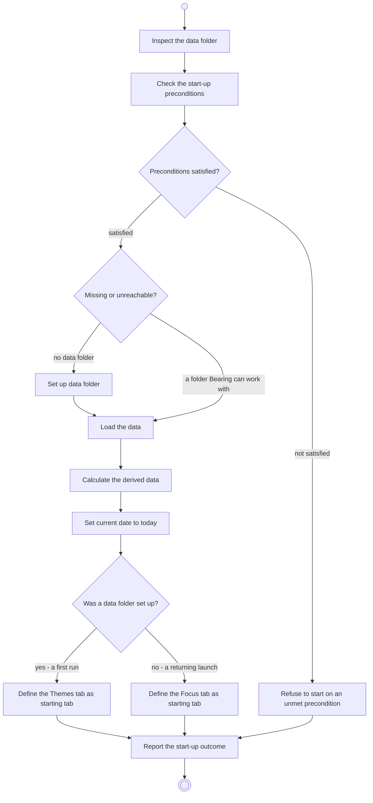

# BP01.01 — Start up

> GENERATED by `bpmn-dsl si-export` — do not edit; the source is the `call` block in the
> `.bpd` (#1182/ADR-068, keyed by call site per ADR-069).
>
> hash: `sha256:e42aaf71ca2bd9733090c3d350de8e5a13818ae08ebef3c27e7330ccec91431e`

## BP01_StartBearing — Activity diagram

### Bound rules

| Where | Rule |
|---|---|
| "Preconditions satisfied?" | `BR-122` |
| "Missing or unreachable?" | `BR-80` |
| Set up data folder | `BR-102` |
| Set current date to today | `BR-44` |
| "Was a data folder set up?" | `BR-48` |
| Report the start-up outcome | `BR-81` |

### Messages

| Where | Message | To | Payload |
|---|---|---|---|
| Start up | Start-up outcome | User | — |

### Notes

- **Start up**: Every precondition is checked before anything of the user's is touched, so a launch that fails them leaves the folder exactly as it was. The template files carry the Chores board and the five life areas, so no step creates them. Today is put in play from no day, never from a previous one: a launch is not a rollover. Loading is the one fetch of stored state in the product: every view works from what is loaded here.
