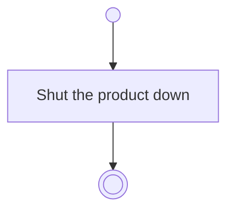

# BP01.09 — Close Bearing

> GENERATED by `bpmn-dsl si-export` — do not edit; the source is the `call` block in the
> `.bpd` (#1182/ADR-068, keyed by call site per ADR-069).
>
> hash: `sha256:6058b15e7c852979a6c6b466445cb1bba129758bd9e15fac036366d3b89de4a6`

## BP01_StartBearing — Activity diagram

