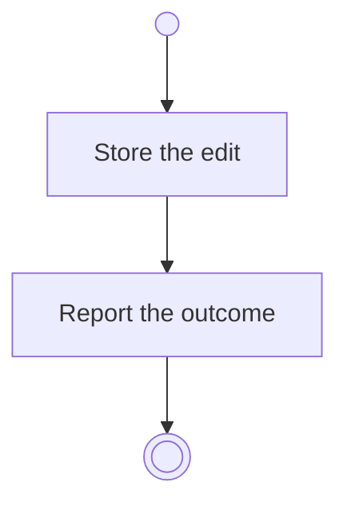

# BP02.02 — Edit a theme

> GENERATED by `bpmn-dsl si-export` — do not edit; the source is the `call` block in the
> `.bpd` (#1182/ADR-068, keyed by call site per ADR-069).
>
> hash: `sha256:da34cb1eb16a9af1832d30b9bc6a4c650df92ac459b9e7eeaf6aa3e4b1197bc3`

## BP02_MaintainLifeThemes — Activity diagram

### Bound rules

| Where | Rule |
|---|---|
| Store the edit | `BR-09` |

### Messages

| Where | Message | To | Payload |
|---|---|---|---|
| Edit a theme | The editing outcome | User | — |
