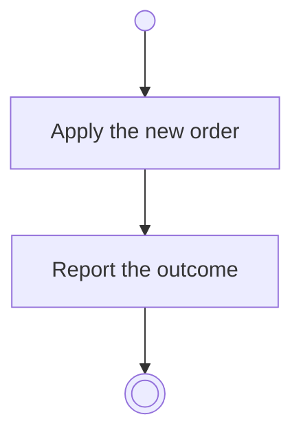

# BP02.04 — Reorder themes

> GENERATED by `bpmn-dsl si-export` — do not edit; the source is the `call` block in the
> `.bpd` (#1182/ADR-068, keyed by call site per ADR-069).
>
> hash: `sha256:48ae5e0a72d7bf38c0da19cbe6ba52ab90fa05477109a8165f80607768bcd08c`

## BP02_MaintainLifeThemes — Activity diagram

### Messages

| Where | Message | To | Payload |
|---|---|---|---|
| Reorder themes | The ordering outcome | User | — |
