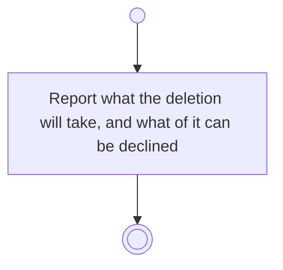

# BP02.05 — See what deleting a theme takes

> GENERATED by `bpmn-dsl si-export` — do not edit; the source is the `call` block in the
> `.bpd` (#1182/ADR-068, keyed by call site per ADR-069).
>
> hash: `sha256:5c64694945463897493a41badde361e8dcbc59eaaaa8a67110a4896f08689342`

## BP02_MaintainLifeThemes — Activity diagram

### Bound rules

| Where | Rule |
|---|---|
| Report what the deletion will take, and what of it can be declined | `BR-12` |
| Report what the deletion will take, and what of it can be declined | `BR-13` |
| Report what the deletion will take, and what of it can be declined | `BR-14` |
| Report what the deletion will take, and what of it can be declined | `BR-15` |
| Report what the deletion will take, and what of it can be declined | `BR-19` |
| Report what the deletion will take, and what of it can be declined | `BR-21` |
| Report what the deletion will take, and what of it can be declined | `BR-117` |

### Messages

| Where | Message | To | Payload |
|---|---|---|---|
| See what deleting a theme takes | What the deletion will take | User | — |

### Notes

- **See what deleting a theme takes**: A goal requires a theme, so keeping one is not a legal outcome: where the theme has goals the gesture is approve-or-abandon. An idea may stay behind theme-less, so that cascade is the real choice and it starts off. An archived descendant is counted like a live one.
