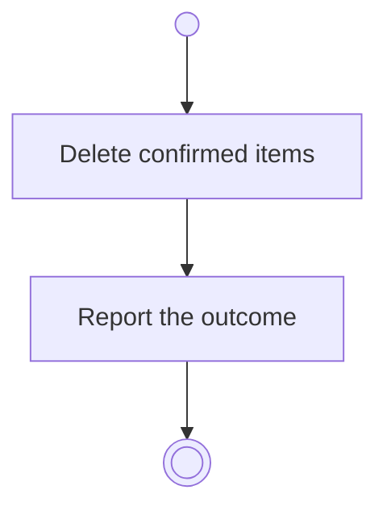

# BP02.06 — Delete a theme

> GENERATED by `bpmn-dsl si-export` — do not edit; the source is the `call` block in the
> `.bpd` (#1182/ADR-068, keyed by call site per ADR-069).
>
> hash: `sha256:4351e3300785cf19f9b8f6b2623a85b8c3e2f509e0605d50cc0d6d3810d36d7f`

## BP02_MaintainLifeThemes — Activity diagram

### Bound rules

| Where | Rule |
|---|---|
| Delete confirmed items | `BR-03` |
| Delete confirmed items | `BR-13` |

### Messages

| Where | Message | To | Payload |
|---|---|---|---|
| Delete a theme | The deletion outcome | User | — |

### Notes

- **Delete a theme**: The request carries the cascades the user confirmed, and nothing else goes: an idea left out stays, theme-less. What happens below a deleted goal or idea is that entity's own rule, applied where the deletion reaches it.
