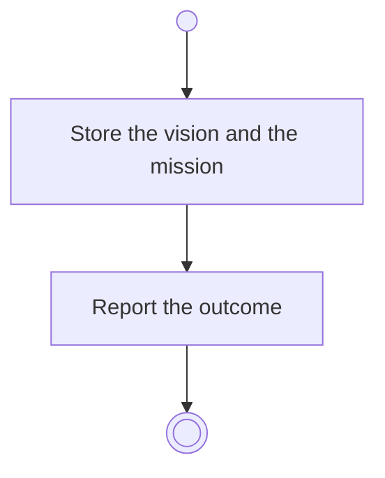

# BP02.08 — Record vision and mission

> GENERATED by `bpmn-dsl si-export` — do not edit; the source is the `call` block in the
> `.bpd` (#1182/ADR-068, keyed by call site per ADR-069).
>
> hash: `sha256:b450eafce1d5e40156d8bf20e967cbfdac96e62a432e5582d156545b25f1aece`

## BP02_MaintainLifeThemes — Activity diagram

### Messages

| Where | Message | To | Payload |
|---|---|---|---|
| Record vision and mission | The recording outcome | User | — |
