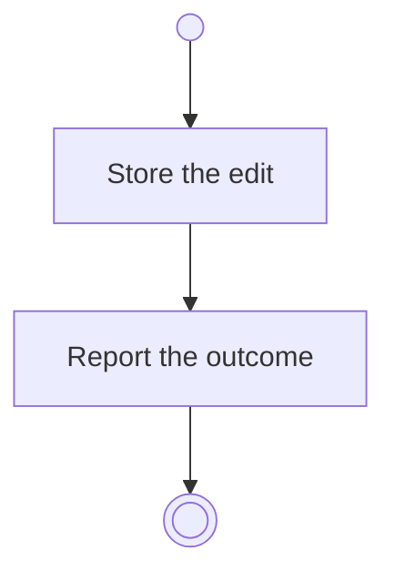

# BP03.02 — Edit a routine

> GENERATED by `bpmn-dsl si-export` — do not edit; the source is the `call` block in the
> `.bpd` (#1182/ADR-068, keyed by call site per ADR-069).
>
> hash: `sha256:bd7903afbade5b885cdd33363bd2f0811b6495a188c926eb04cd4b51b5429237`

## BP03_MaintainRoutines — Activity diagram

### Bound rules

| Where | Rule |
|---|---|
| Store the edit | `BR-94` |
| Store the edit | `BR-02` |

### Messages

| Where | Message | To | Payload |
|---|---|---|---|
| Edit a routine | The editing outcome | User | — |

### Notes

- **Edit a routine**: A routine carries no life area. The recurrence is Daily, Weekly, Monthly or Yearly.
