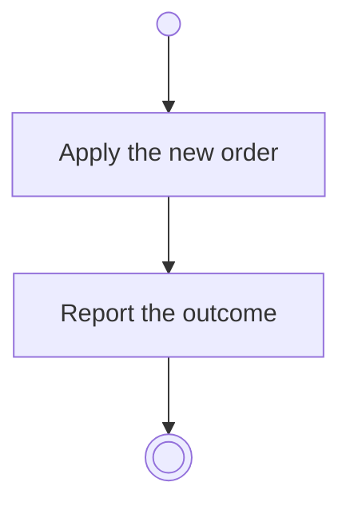

# BP03.05 — Reorder routines

> GENERATED by `bpmn-dsl si-export` — do not edit; the source is the `call` block in the
> `.bpd` (#1182/ADR-068, keyed by call site per ADR-069).
>
> hash: `sha256:b42c4d07b7c4d54c326886601dcdf56f6bf1663552f49825ed4dbcc132cb1b82`

## BP03_MaintainRoutines — Activity diagram

### Messages

| Where | Message | To | Payload |
|---|---|---|---|
| Reorder routines | The ordering outcome | User | — |
