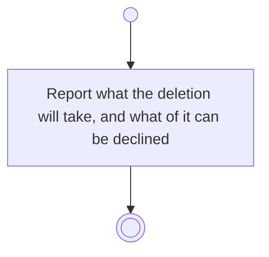

# BP03.06 — See what deleting a routine takes

> GENERATED by `bpmn-dsl si-export` — do not edit; the source is the `call` block in the
> `.bpd` (#1182/ADR-068, keyed by call site per ADR-069).
>
> hash: `sha256:61905cc025c2ed565ada08b59c6932e563a5793bc977402ed0c534bb9ce3d1a2`

## BP03_MaintainRoutines — Activity diagram

### Bound rules

| Where | Rule |
|---|---|
| Report what the deletion will take, and what of it can be declined | `BR-12` |
| Report what the deletion will take, and what of it can be declined | `BR-19` |
| Report what the deletion will take, and what of it can be declined | `BR-117` |

### Messages

| Where | Message | To | Payload |
|---|---|---|---|
| See what deleting a routine takes | What the deletion will take | User | — |

### Notes

- **See what deleting a routine takes**: The occurrences are a declinable cascade, so it starts off. Declining leaves them on Chores and stops the routine producing new ones.
