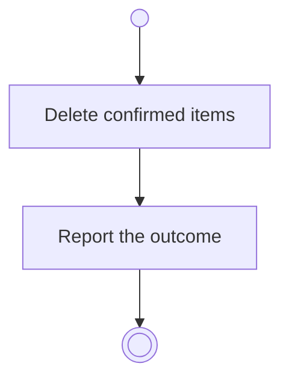

# BP03.07 — Delete a routine

> GENERATED by `bpmn-dsl si-export` — do not edit; the source is the `call` block in the
> `.bpd` (#1182/ADR-068, keyed by call site per ADR-069).
>
> hash: `sha256:600685ccc1c22e3ce2cd7aac0b3880f04aa1b32e255f1fabf8ae9ca59d2b8c82`

## BP03_MaintainRoutines — Activity diagram

### Bound rules

| Where | Rule |
|---|---|
| Delete confirmed items | `BR-16` |

### Messages

| Where | Message | To | Payload |
|---|---|---|---|
| Delete a routine | The deletion outcome | User | — |

### Notes

- **Delete a routine**: The request carries the cascade the user approved.
