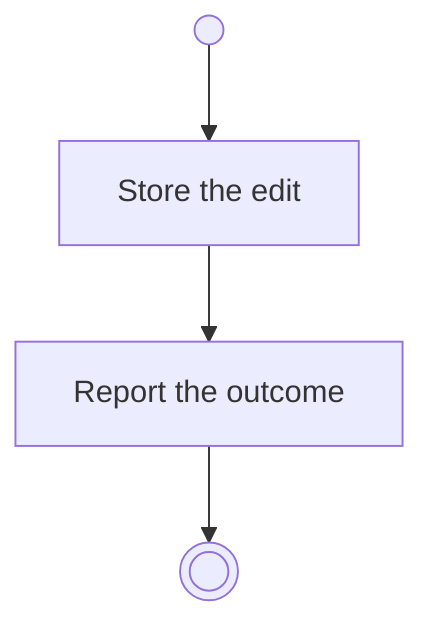

# BP04.02 — Edit an idea

> GENERATED by `bpmn-dsl si-export` — do not edit; the source is the `call` block in the
> `.bpd` (#1182/ADR-068, keyed by call site per ADR-069).
>
> hash: `sha256:def45804a625a1685ad119a97d1cf3628fc7e26d4f600f299f6d68cfde387900`

## BP04_CaptureAndCurateIdeas — Activity diagram

### Bound rules

| Where | Rule |
|---|---|
| Store the edit | `BR-03` |
| Store the edit | `BR-05` |

### Messages

| Where | Message | To | Payload |
|---|---|---|---|
| Edit an idea | The editing outcome | User | — |

### Notes

- **Edit an idea**: The theme may be absent. An archived idea is not editable.
