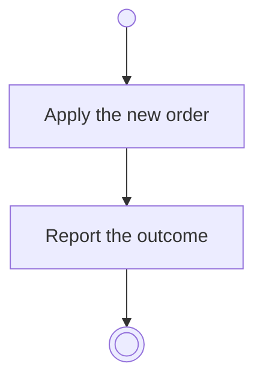

# BP04.05 — Reorder ideas

> GENERATED by `bpmn-dsl si-export` — do not edit; the source is the `call` block in the
> `.bpd` (#1182/ADR-068, keyed by call site per ADR-069).
>
> hash: `sha256:0852b834a05380d705d5b9f383af92a0064edba465b0c898f3a0e7ab7770652a`

## BP04_CaptureAndCurateIdeas — Activity diagram

### Messages

| Where | Message | To | Payload |
|---|---|---|---|
| Reorder ideas | The ordering outcome | User | — |
