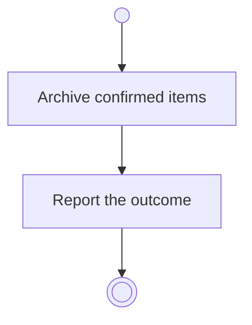

# BP04.07 — Archive an idea

> GENERATED by `bpmn-dsl si-export` — do not edit; the source is the `call` block in the
> `.bpd` (#1182/ADR-068, keyed by call site per ADR-069).
>
> hash: `sha256:a5e18813d7dd76c10664b4d7673f70ac1d2a71b9decab392487b746f9d119d26`

## BP04_CaptureAndCurateIdeas — Activity diagram

### Bound rules

| Where | Rule |
|---|---|
| Archive confirmed items | `BR-112` |
| Archive confirmed items | `BR-43` |

### Messages

| Where | Message | To | Payload |
|---|---|---|---|
| Archive an idea | The archiving outcome | User | — |

### Notes

- **Archive an idea**: Unarchiving restores the whole bundle.
