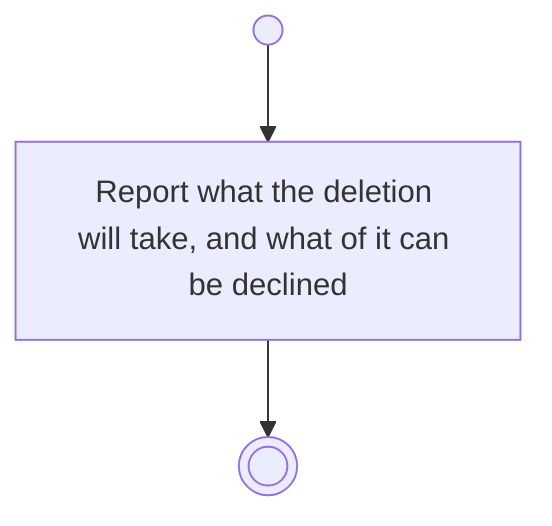

# BP04.08 — See what deleting an idea takes

> GENERATED by `bpmn-dsl si-export` — do not edit; the source is the `call` block in the
> `.bpd` (#1182/ADR-068, keyed by call site per ADR-069).
>
> hash: `sha256:ec882556ccbe4d5722de6bdf521715d80fcb472070819f5fbe387a53ce5d6cac`

## BP04_CaptureAndCurateIdeas — Activity diagram

### Bound rules

| Where | Rule |
|---|---|
| Report what the deletion will take, and what of it can be declined | `BR-12` |
| Report what the deletion will take, and what of it can be declined | `BR-14` |
| Report what the deletion will take, and what of it can be declined | `BR-19` |
| Report what the deletion will take, and what of it can be declined | `BR-117` |

### Messages

| Where | Message | To | Payload |
|---|---|---|---|
| See what deleting an idea takes | What the deletion will take | User | — |

### Notes

- **See what deleting an idea takes**: Keeping a project behind is not offered. A goal that links the idea survives minus the link.
