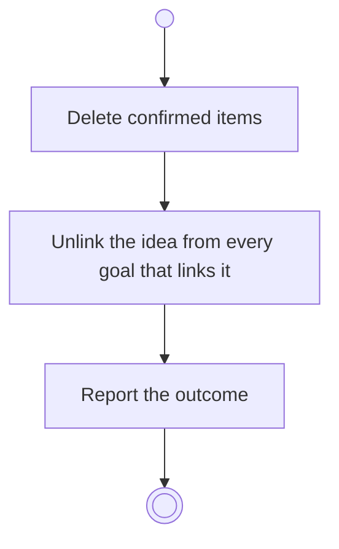

# BP04.09 — Delete an idea

> GENERATED by `bpmn-dsl si-export` — do not edit; the source is the `call` block in the
> `.bpd` (#1182/ADR-068, keyed by call site per ADR-069).
>
> hash: `sha256:391e96b8c7aa2510f05ebfe2a847e8af7452921eae2b90d9b444a9df0d0b6415`

## BP04_CaptureAndCurateIdeas — Activity diagram

### Bound rules

| Where | Rule |
|---|---|
| Delete confirmed items | `BR-14` |

### Messages

| Where | Message | To | Payload |
|---|---|---|---|
| Delete an idea | The deletion outcome | User | — |

### Notes

- **Delete an idea**: A goal left with no linked idea is flagged on its current state.
