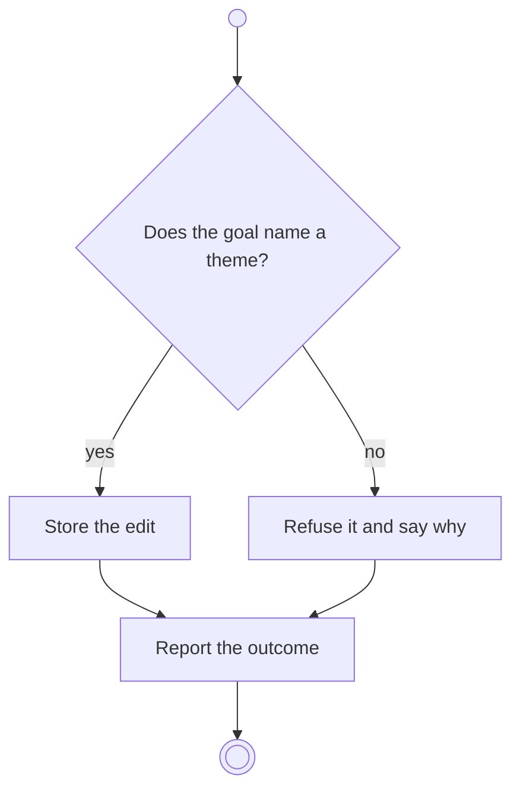

# BP04.11 — Define a goal

> GENERATED by `bpmn-dsl si-export` — do not edit; the source is the `call` block in the
> `.bpd` (#1182/ADR-068, keyed by call site per ADR-069).
>
> hash: `sha256:a0392353ae7e2814628506bab9c6a3fafb4429f87fd108a7c50c8831e1f8afeb`

## BP04_CaptureAndCurateIdeas — Activity diagram

### Bound rules

| Where | Rule |
|---|---|
| "Does the goal name a theme?" | `BR-01` |
| Store the edit | `BR-04` |
| Store the edit | `BR-08` |
| Refuse it and say why | `BR-84` |

### Messages

| Where | Message | To | Payload |
|---|---|---|---|
| Define a goal | The editing outcome | User | — |

### Notes

- **Define a goal**: The idea comes in as one of the ideas behind the goal. A theme-less idea gives the goal no theme, and a goal without one is refused, which is the same answer the Goals view's own editor gives.
