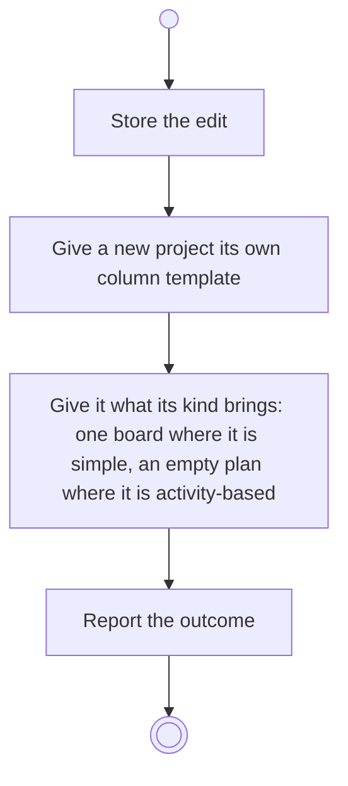

# BP04.12 — Create a project

> GENERATED by `bpmn-dsl si-export` — do not edit; the source is the `call` block in the
> `.bpd` (#1182/ADR-068, keyed by call site per ADR-069).
>
> hash: `sha256:3eff7626c9c01c1326f653d6e224643baf65964f85b4e4c8d1a6c87735cdfe4a`

## BP04_CaptureAndCurateIdeas — Activity diagram

### Bound rules

| Where | Rule |
|---|---|
| Store the edit | `BR-96` |
| Store the edit | `BR-97` |
| Give a new project its own column template | `BR-108` |
| Give it what its kind brings: one board where it is simple, an empty plan where it is activity-based | `BR-101` |
| Give it what its kind brings: one board where it is simple, an empty plan where it is activity-based | `BR-111` |

### Messages

| Where | Message | To | Payload |
|---|---|---|---|
| Create a project | The editing outcome | User | — |

### Notes

- **Create a project**: The parent is the idea, carried in from where the user started. The kind is declared once and for the project's life.
