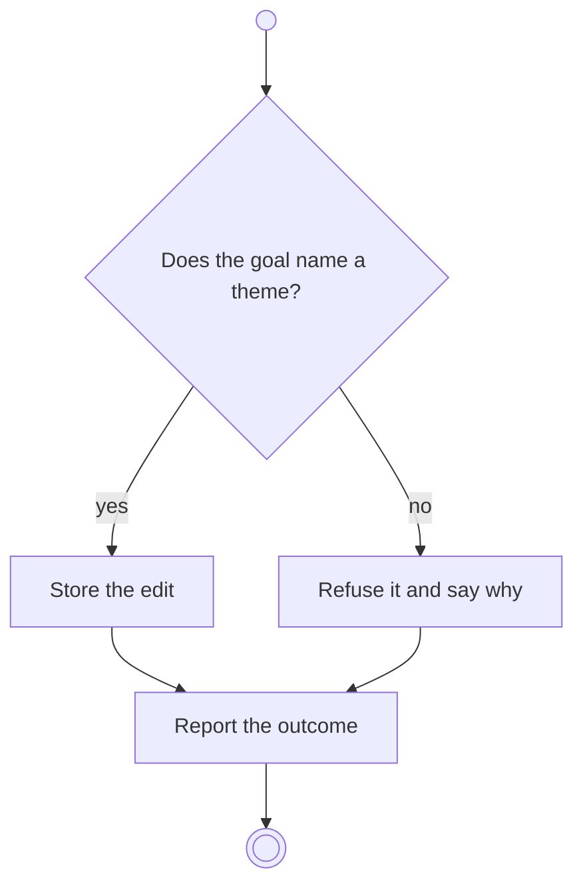

# BP05.02 — Edit a goal

> GENERATED by `bpmn-dsl si-export` — do not edit; the source is the `call` block in the
> `.bpd` (#1182/ADR-068, keyed by call site per ADR-069).
>
> hash: `sha256:d34c1074945a3e44deb00e1c1d6b93216f4498af01dcb6c013da14261e9dba2a`

## BP05_CommitToAndMaintainAGoal — Activity diagram

### Bound rules

| Where | Rule |
|---|---|
| "Does the goal name a theme?" | `BR-01` |
| Store the edit | `BR-04` |
| Store the edit | `BR-08` |
| Refuse it and say why | `BR-84` |

### Messages

| Where | Message | To | Payload |
|---|---|---|---|
| Edit a goal | The editing outcome | User | — |

### Notes

- **Edit a goal**: The horizon may be absent. The ideas behind the goal are chosen in the same editor, and a goal with none stays legitimate and is flagged as such.
