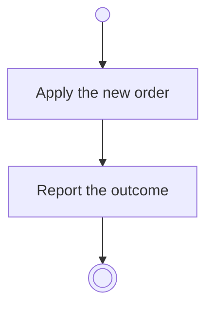

# BP05.11 — Reorder goals within a theme

> GENERATED by `bpmn-dsl si-export` — do not edit; the source is the `call` block in the
> `.bpd` (#1182/ADR-068, keyed by call site per ADR-069).
>
> hash: `sha256:bd573caf5bc60792691cc36597d1643ef7ddfc500c10818ba900bca359055043`

## BP05_CommitToAndMaintainAGoal — Activity diagram

### Messages

| Where | Message | To | Payload |
|---|---|---|---|
| Reorder goals within a theme | The ordering outcome | User | — |
