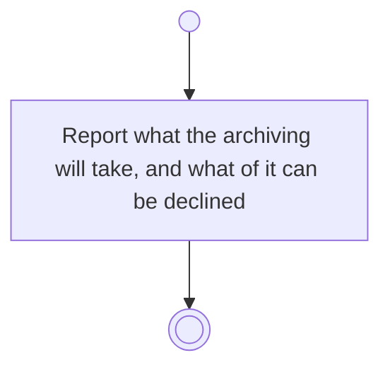

# BP05.12 — See what archiving a goal takes

> GENERATED by `bpmn-dsl si-export` — do not edit; the source is the `call` block in the
> `.bpd` (#1182/ADR-068, keyed by call site per ADR-069).
>
> hash: `sha256:84018b502bc65ca7f57cd6822f24469e02d540417c70a02abf38e65fb0cea57d`

## BP05_CommitToAndMaintainAGoal — Activity diagram

### Bound rules

| Where | Rule |
|---|---|
| Report what the archiving will take, and what of it can be declined | `BR-19` |
| Report what the archiving will take, and what of it can be declined | `BR-112` |

### Messages

| Where | Message | To | Payload |
|---|---|---|---|
| See what archiving a goal takes | What the archiving will take | User | — |

### Notes

- **See what archiving a goal takes**: Cascade, the goal alone, or reject. The keep answer is legal here because an archived goal still exists.
