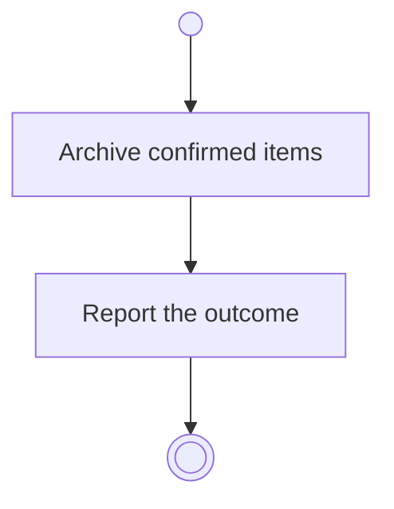

# BP05.13 — Archive a goal

> GENERATED by `bpmn-dsl si-export` — do not edit; the source is the `call` block in the
> `.bpd` (#1182/ADR-068, keyed by call site per ADR-069).
>
> hash: `sha256:ee83ac58355a83179c0415f2b288ec9a25b6712ec8db79a4e4e3a1e219b09ee7`

## BP05_CommitToAndMaintainAGoal — Activity diagram

### Bound rules

| Where | Rule |
|---|---|
| Archive confirmed items | `BR-23` |
| Archive confirmed items | `BR-112` |
| Archive confirmed items | `BR-43` |

### Messages

| Where | Message | To | Payload |
|---|---|---|---|
| Archive a goal | The archiving outcome | User | — |

### Notes

- **Archive a goal**: Archiving is independent of closing out. A check-out record already attached stays with the goal.
