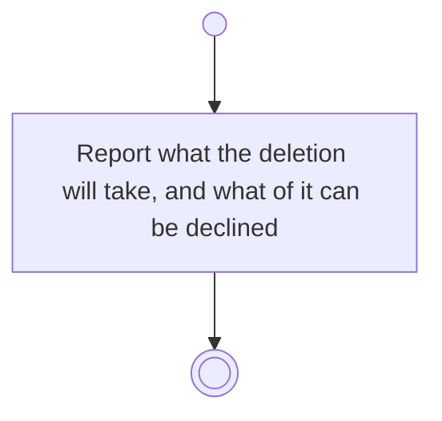

# BP05.14 — See what deleting a goal takes

> GENERATED by `bpmn-dsl si-export` — do not edit; the source is the `call` block in the
> `.bpd` (#1182/ADR-068, keyed by call site per ADR-069).
>
> hash: `sha256:a0bd2214c337711ce1efd6b695438ed606a01e202a4e81b06cb0c6ad18d17b44`

## BP05_CommitToAndMaintainAGoal — Activity diagram

### Bound rules

| Where | Rule |
|---|---|
| Report what the deletion will take, and what of it can be declined | `BR-12` |
| Report what the deletion will take, and what of it can be declined | `BR-15` |
| Report what the deletion will take, and what of it can be declined | `BR-19` |
| Report what the deletion will take, and what of it can be declined | `BR-117` |

### Messages

| Where | Message | To | Payload |
|---|---|---|---|
| See what deleting a goal takes | What the deletion will take | User | — |

### Notes

- **See what deleting a goal takes**: The measures and their history go unasked. The linked ideas are a cascade the user may decline. Keeping a project behind is not offered.
