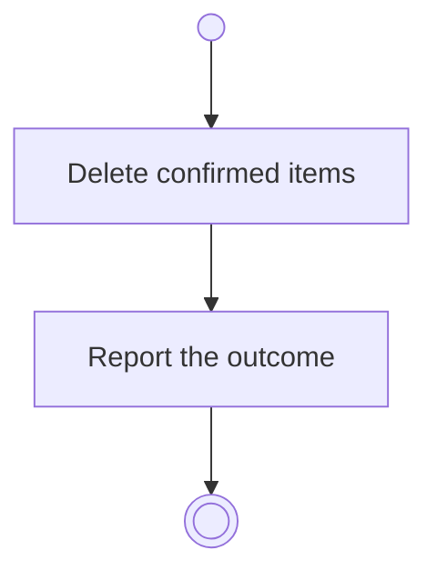

# BP05.15 — Delete a goal

> GENERATED by `bpmn-dsl si-export` — do not edit; the source is the `call` block in the
> `.bpd` (#1182/ADR-068, keyed by call site per ADR-069).
>
> hash: `sha256:1b8463c607b195b0cd9cbe78a8e368df9c7c5174b4b9e8f4f6ca1216ec480c03`

## BP05_CommitToAndMaintainAGoal — Activity diagram

### Bound rules

| Where | Rule |
|---|---|
| Delete confirmed items | `BR-15` |

### Messages

| Where | Message | To | Payload |
|---|---|---|---|
| Delete a goal | The deletion outcome | User | — |
