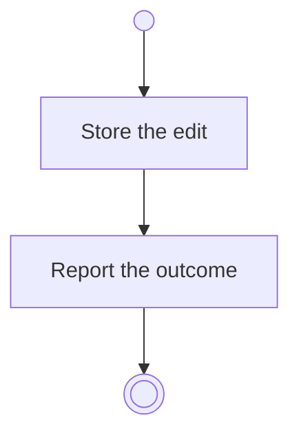

# BP06.03 — Edit a progress measure

> GENERATED by `bpmn-dsl si-export` — do not edit; the source is the `call` block in the
> `.bpd` (#1182/ADR-068, keyed by call site per ADR-069).
>
> hash: `sha256:8f9845c959c42756c429469f7d2c182da513b55394af04851a5666f6a9c425f8`

## BP06_MeasureGoalProgress — Activity diagram

### Bound rules

| Where | Rule |
|---|---|
| Store the edit | `BR-28` |

### Messages

| Where | Message | To | Payload |
|---|---|---|---|
| Edit a progress measure | The editing outcome | User | — |

### Notes

- **Edit a progress measure**: There is no untyped measure. The type is editable like the start value, the target and the unit, and the check-ins already recorded are left as they stand, each in the type it was recorded under.
