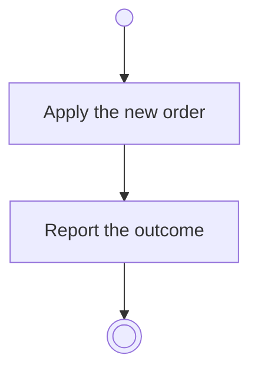

# BP06.05 — Reorder progress measures

> GENERATED by `bpmn-dsl si-export` — do not edit; the source is the `call` block in the
> `.bpd` (#1182/ADR-068, keyed by call site per ADR-069).
>
> hash: `sha256:aa70ede25b0e752d58ff701066e7ba77acbfc41b0f7caba88efa3a1ab4e4755c`

## BP06_MeasureGoalProgress — Activity diagram

### Messages

| Where | Message | To | Payload |
|---|---|---|---|
| Reorder progress measures | The ordering outcome | User | — |
