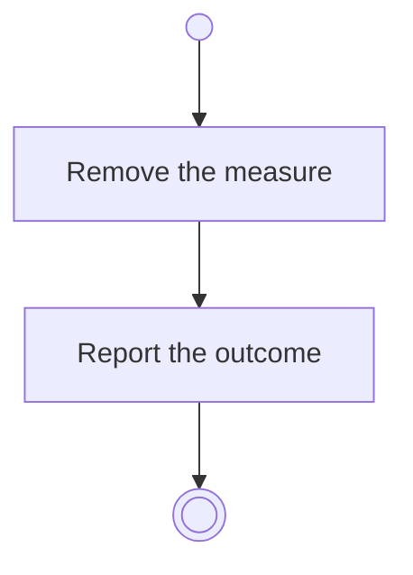

# BP06.07 — Remove a progress measure

> GENERATED by `bpmn-dsl si-export` — do not edit; the source is the `call` block in the
> `.bpd` (#1182/ADR-068, keyed by call site per ADR-069).
>
> hash: `sha256:e36218f4fc285e0ec46ec3b7c0a693b94188111bf14669b4642a2f824cefec91`

## BP06_MeasureGoalProgress — Activity diagram

### Bound rules

| Where | Rule |
|---|---|
| Remove the measure | `BR-115` |

### Messages

| Where | Message | To | Payload |
|---|---|---|---|
| Remove a progress measure | The removal outcome | User | — |
