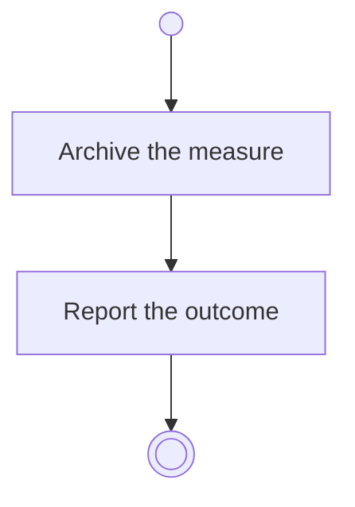

# BP06.11 — Archive a progress measure

> GENERATED by `bpmn-dsl si-export` — do not edit; the source is the `call` block in the
> `.bpd` (#1182/ADR-068, keyed by call site per ADR-069).
>
> hash: `sha256:e01c5d4f581abfba83b3e172795d2c5c9e722ef49c88c763a8eb398093cc95ce`

## BP06_MeasureGoalProgress — Activity diagram

### Bound rules

| Where | Rule |
|---|---|
| Archive the measure | `BR-23` |

### Messages

| Where | Message | To | Payload |
|---|---|---|---|
| Archive a progress measure | The archiving outcome | User | — |

### Notes

- **Archive a progress measure**: Its check-in history goes with it and comes back with it, into a live goal. While it is away it is frozen, so nothing is recorded against it.
