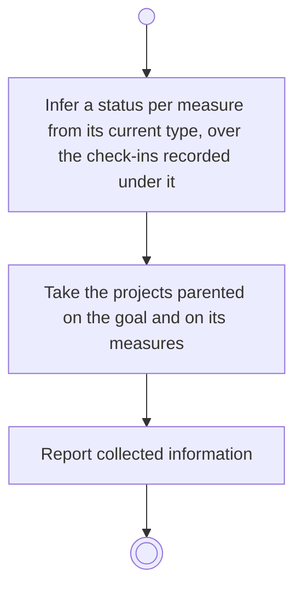

# BP07.01 — Read the inferred statuses and the linked projects

> GENERATED by `bpmn-dsl si-export` — do not edit; the source is the `call` block in the
> `.bpd` (#1182/ADR-068, keyed by call site per ADR-069).
>
> hash: `sha256:9432727a7928beaa29c16d6cd92c73d7f74755a416a2b163a1eebbcb92167540`

## BP07_CheckOutAGoal — Activity diagram

### Bound rules

| Where | Rule |
|---|---|
| Infer a status per measure from its current type, over the check-ins recorded under it | `BR-28` |
| Infer a status per measure from its current type, over the check-ins recorded under it | `BR-29` |
| Take the projects parented on the goal and on its measures | `BR-112` |
| Report collected information | `BR-39` |

### Messages

| Where | Message | To | Payload |
|---|---|---|---|
| Read the inferred statuses and the linked projects | A status inferred per measure, and the goal's linked projects | User | — |

### Notes

- **Read the inferred statuses and the linked projects**: This is what the system observed, which the user then judges: the statuses are inferred and never decided. The goal and its measures came with the goals, so nothing re-reads them; their linked projects did not, and the sitting settles the archiving on them. A check-out is available at any time, with or without a horizon.
