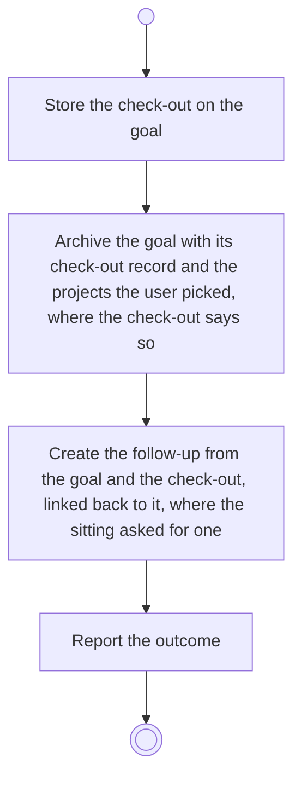

# BP07.04 — Check the goal out

> GENERATED by `bpmn-dsl si-export` — do not edit; the source is the `call` block in the
> `.bpd` (#1182/ADR-068, keyed by call site per ADR-069).
>
> hash: `sha256:0f10ec0510d5cce3e26cdd3668baac563293f69c40b1d331c97708145b672d46`

## BP07_CheckOutAGoal — Activity diagram

### Bound rules

| Where | Rule |
|---|---|
| Store the check-out on the goal | `BR-27` |
| Archive the goal with its check-out record and the projects the user picked, where the check-out says so | `BR-112` |
| Archive the goal with its check-out record and the projects the user picked, where the check-out says so | `BR-23` |
| Create the follow-up from the goal and the check-out, linked back to it, where the sitting asked for one | `BR-31` |

### Messages

| Where | Message | To | Payload |
|---|---|---|---|
| Check the goal out | The check-out outcome | User | — |

### Notes

- **Check the goal out**: The check-out record stays attached to the goal, archived or not, and unarchiving never revokes it. The follow-up inherits the theme and the linked ideas, carries the objective over as a continuation, takes the Partial and Missed measures with their progress reset, advances a horizon that existed, drops the check-out notes, and keeps the link back to the check-out that keeps the iteration chain traceable.
