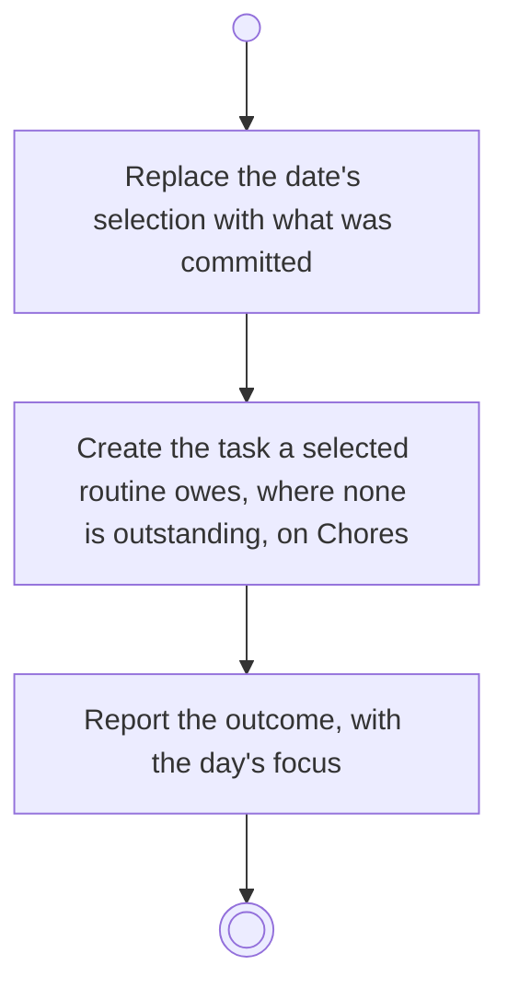

# BP08.02 — Set the day's focus

> GENERATED by `bpmn-dsl si-export` — do not edit; the source is the `call` block in the
> `.bpd` (#1182/ADR-068, keyed by call site per ADR-069).
>
> hash: `sha256:6d685fda369ca826acdb03dafea0e73d31d55a400316ee28ba9f84cf2e14eb51`

## BP08_SetADaysFocus — Activity diagram

### Bound rules

| Where | Rule |
|---|---|
| Replace the date's selection with what was committed | `BR-41` |
| Create the task a selected routine owes, where none is outstanding, on Chores | `BR-42` |
| Create the task a selected routine owes, where none is outstanding, on Chores | `BR-102` |

### Messages

| Where | Message | To | Payload |
|---|---|---|---|
| Set the day's focus | What was committed, or why not | User | — |

### Notes

- **Set the day's focus**: A commit replaces the date's previous selection rather than adding to it, so the boards in play are exactly what was last committed. A routine that already owes a task gets no second one, on any date. Due and overdue are treated the same. Dropping a routine leaves a task already created where it is.
