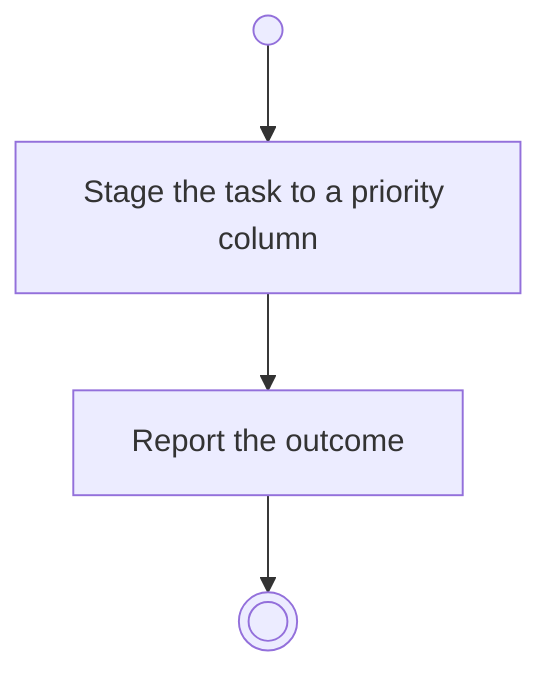

# BP10.02 — Stage a task

> GENERATED by `bpmn-dsl si-export` — do not edit; the source is the `call` block in the
> `.bpd` (#1182/ADR-068, keyed by call site per ADR-069).
>
> hash: `sha256:de6a19c825f86eada790d85a2f5df11ce97073cbe5de6de092892add3667c3b0`

## BP10_CaptureTasks — Activity diagram

### Bound rules

| Where | Rule |
|---|---|
| Stage the task to a priority column | `BR-53` |

### Messages

| Where | Message | To | Payload |
|---|---|---|---|
| Stage a task | The staging outcome | User | — |

### Notes

- **Stage a task**: A staged task is not a commit. It is kept outside version control.
