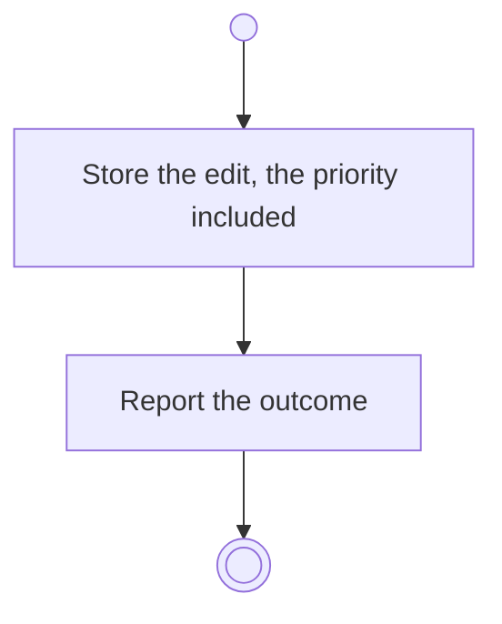

# BP10.03 — Edit a staged task

> GENERATED by `bpmn-dsl si-export` — do not edit; the source is the `call` block in the
> `.bpd` (#1182/ADR-068, keyed by call site per ADR-069).
>
> hash: `sha256:8b2f60f1161d8ff48e9a92f86eb1e06609dc8f6904186653b4eb4cee5b839924`

## BP10_CaptureTasks — Activity diagram

### Bound rules

| Where | Rule |
|---|---|
| Store the edit, the priority included | `BR-53` |

### Messages

| Where | Message | To | Payload |
|---|---|---|---|
| Edit a staged task | The editing outcome | User | — |

### Notes

- **Edit a staged task**: A staged task is never on a board, so its priority is open for as long as the batch is uncommitted.
