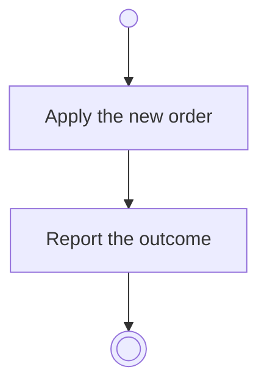

# BP10.04 — Reorder staged tasks

> GENERATED by `bpmn-dsl si-export` — do not edit; the source is the `call` block in the
> `.bpd` (#1182/ADR-068, keyed by call site per ADR-069).
>
> hash: `sha256:b0dfd918ca766f3b00edc13faa8c4feeb75f3a6e9386300d105350a5d7abb22f`

## BP10_CaptureTasks — Activity diagram

### Messages

| Where | Message | To | Payload |
|---|---|---|---|
| Reorder staged tasks | The ordering outcome | User | — |
