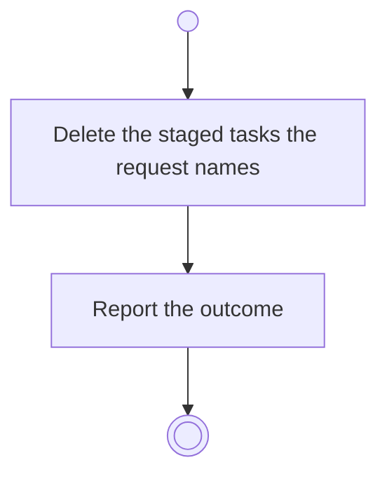

# BP10.05 — Discard staged tasks

> GENERATED by `bpmn-dsl si-export` — do not edit; the source is the `call` block in the
> `.bpd` (#1182/ADR-068, keyed by call site per ADR-069).
>
> hash: `sha256:7dc10b6093d4220efdc392d7ea1b7fb480c49900acaa5553a98a46bf691e94bf`

## BP10_CaptureTasks — Activity diagram

### Messages

| Where | Message | To | Payload |
|---|---|---|---|
| Discard staged tasks | The discard outcome | User | — |
