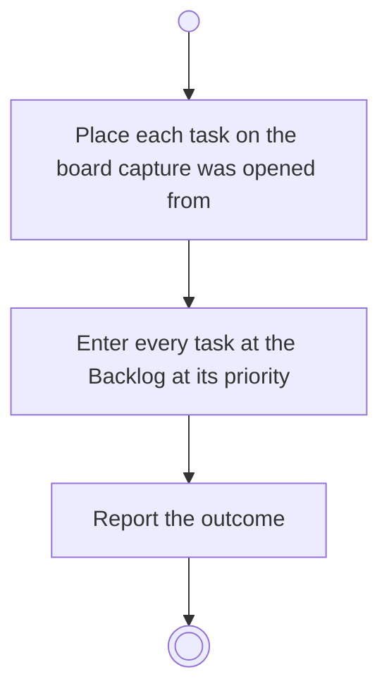

# BP10.06 — Commit the staged tasks

> GENERATED by `bpmn-dsl si-export` — do not edit; the source is the `call` block in the
> `.bpd` (#1182/ADR-068, keyed by call site per ADR-069).
>
> hash: `sha256:ffd2c3e36416a78b951f3e39801fd3722077f3280aba9b53bc4b148839b60fb2`

## BP10_CaptureTasks — Activity diagram

### Bound rules

| Where | Rule |
|---|---|
| Place each task on the board capture was opened from | `BR-62` |
| Place each task on the board capture was opened from | `BR-103` |
| Place each task on the board capture was opened from | `BR-90` |
| Enter every task at the Backlog at its priority | `BR-55` |

### Messages

| Where | Message | To | Payload |
|---|---|---|---|
| Commit the staged tasks | The commit outcome | User | — |

### Notes

- **Commit the staged tasks**: Every task in the batch lands on the board capture was opened from - a project's board, or Chores where that is the board the user is on. Capture names no board and creates none. The batch commits as one act.
