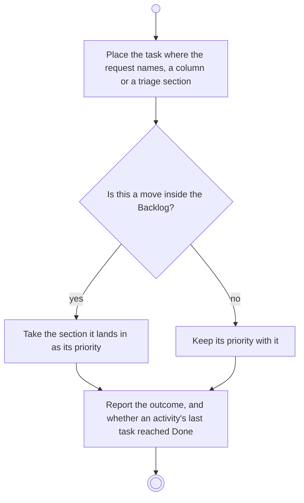

# BP11.03 — Move a task

> GENERATED by `bpmn-dsl si-export` — do not edit; the source is the `call` block in the
> `.bpd` (#1182/ADR-068, keyed by call site per ADR-069).
>
> hash: `sha256:53b08854e997a3312173989eac7da8d1b2958d1b2d8308b36b6142b5016609b7`

## BP11_WorkTheBoard — Activity diagram

### Bound rules

| Where | Rule |
|---|---|
| Place the task where the request names, a column or a triage section | `BR-64` |
| Place the task where the request names, a column or a triage section | `BR-126` |
| "Is this a move inside the Backlog?" | `BR-56` |
| Take the section it lands in as its priority | `BR-54` |
| Keep its priority with it | `BR-54` |
| Report the outcome, and whether an activity's last task reached Done | `BR-109` |

### Messages

| Where | Message | To | Payload |
|---|---|---|---|
| Move a task | The move's outcome | User | — |

### Notes

- **Move a task**: A task never moves to another board. Returning it to the Backlog re-opens its triage.
