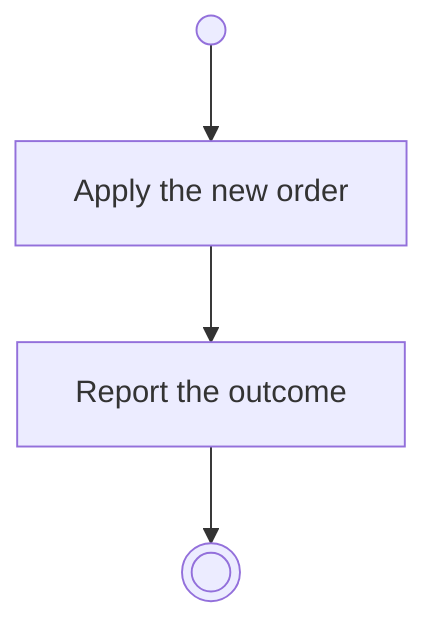

# BP11.05 — Order a task

> GENERATED by `bpmn-dsl si-export` — do not edit; the source is the `call` block in the
> `.bpd` (#1182/ADR-068, keyed by call site per ADR-069).
>
> hash: `sha256:cd3230e7e5a65707c06bf3caf9d2b6bd9e24a8572c0565d03567e41e8f1a8414`

## BP11_WorkTheBoard — Activity diagram

### Messages

| Where | Message | To | Payload |
|---|---|---|---|
| Order a task | The ordering outcome | User | — |
