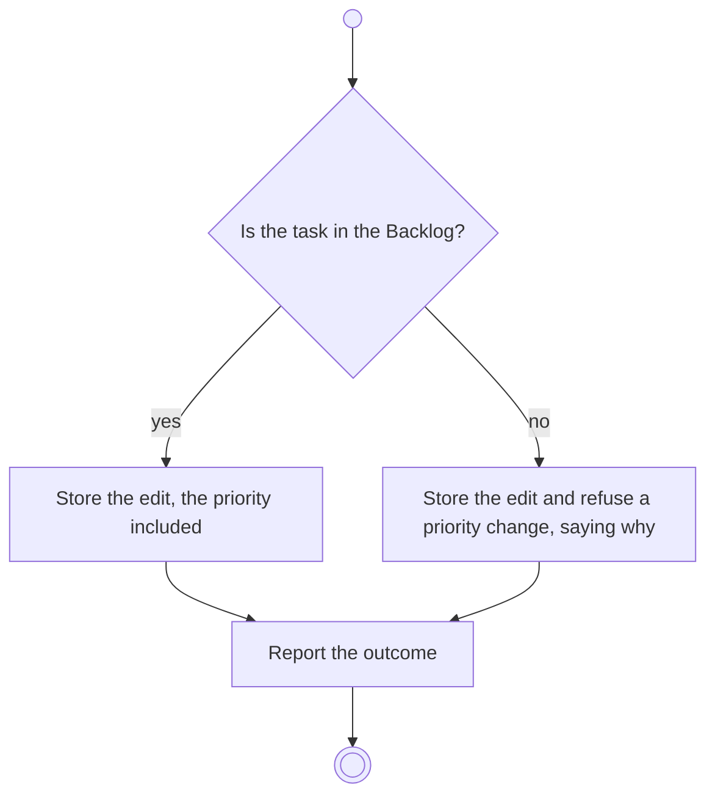

# BP11.06 — Edit a task

> GENERATED by `bpmn-dsl si-export` — do not edit; the source is the `call` block in the
> `.bpd` (#1182/ADR-068, keyed by call site per ADR-069).
>
> hash: `sha256:1dc54b5b81ce05bf39a776f40898b0002de0055f6d467e8879087946e2c45c93`

## BP11_WorkTheBoard — Activity diagram

### Bound rules

| Where | Rule |
|---|---|
| "Is the task in the Backlog?" | `BR-56` |
| Store the edit, the priority included | `BR-53` |
| Store the edit, the priority included | `BR-64` |
| Store the edit and refuse a priority change, saying why | `BR-64` |

### Messages

| Where | Message | To | Payload |
|---|---|---|---|
| Edit a task | The editing outcome | User | — |

### Notes

- **Edit a task**: The board and the column are untouched by an edit. Triage happens at intake, so the priority is changeable only in the Backlog; the three are Important and Urgent, Not Important and Urgent, and Important and Not Urgent.
