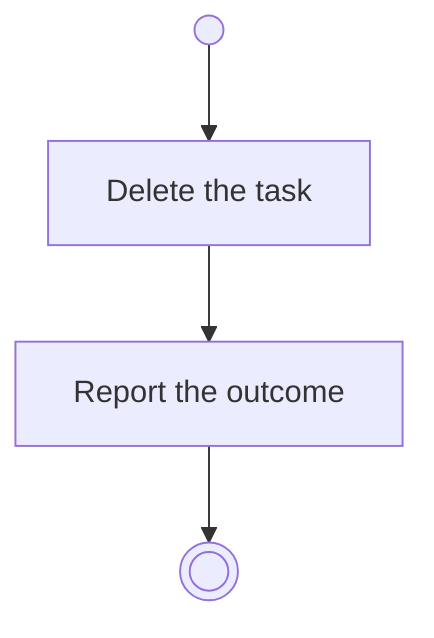

# BP11.08 — Delete a task

> GENERATED by `bpmn-dsl si-export` — do not edit; the source is the `call` block in the
> `.bpd` (#1182/ADR-068, keyed by call site per ADR-069).
>
> hash: `sha256:5e10805246971223632952cedca4f8a8a05ede3d8f87be6212d8f25f0c2bdc64`

## BP11_WorkTheBoard — Activity diagram

### Bound rules

| Where | Rule |
|---|---|
| Delete the task | `BR-17` |

### Messages

| Where | Message | To | Payload |
|---|---|---|---|
| Delete a task | The deletion outcome | User | — |

### Notes

- **Delete a task**: A task owns nothing, so nothing goes with it.
