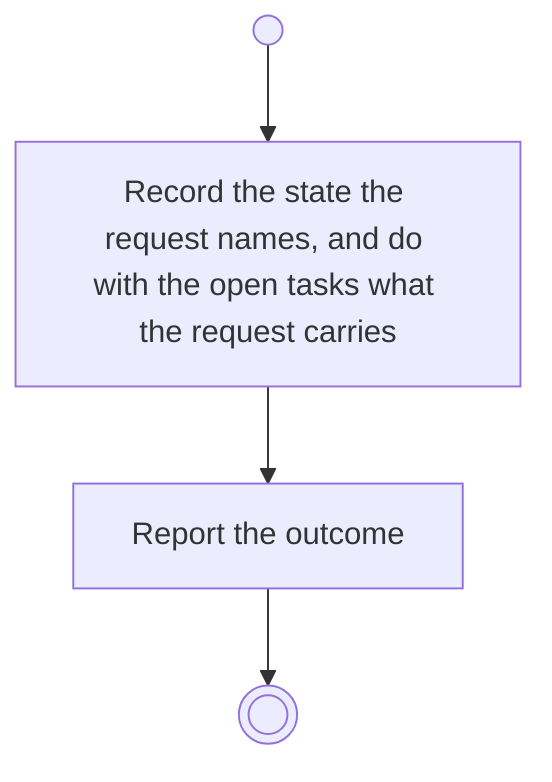

# BP11.09 — Set the activity Done

> GENERATED by `bpmn-dsl si-export` — do not edit; the source is the `call` block in the
> `.bpd` (#1182/ADR-068, keyed by call site per ADR-069).
>
> hash: `sha256:76bcbf28fc0c33ca68d4684d05565c0e4c24bcf1b11b17c1ea88a0598a80d8f9`

## BP11_WorkTheBoard — Activity diagram

### Bound rules

| Where | Rule |
|---|---|
| Record the state the request names, and do with the open tasks what the request carries | `BR-109` |
| Record the state the request names, and do with the open tasks what the request carries | `BR-127` |
| Record the state the request names, and do with the open tasks what the request carries | `BR-23` |

### Messages

| Where | Message | To | Payload |
|---|---|---|---|
| Set the activity Done | The state-change outcome | User | — |

### Notes

- **Set the activity Done**: The Course page owns an activity's state (BP18); this is the completion offer answered from the board. A Done activity can be reopened there.
