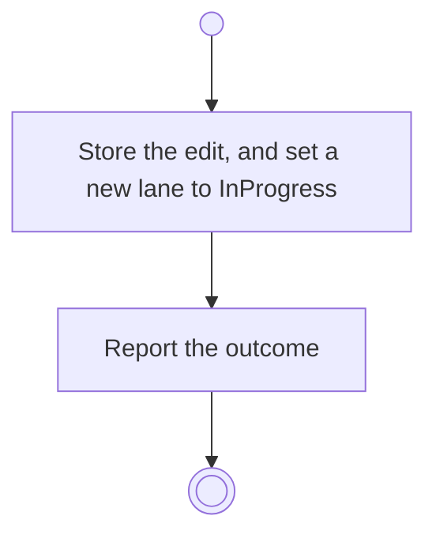

# BP12.02 — Edit a column

> GENERATED by `bpmn-dsl si-export` — do not edit; the source is the `call` block in the
> `.bpd` (#1182/ADR-068, keyed by call site per ADR-069).
>
> hash: `sha256:6ba691498642bed5f011d82bfe4f6cd13e50c08515611fba267291341dcd40b6`

## BP12_ManageBoardColumns — Activity diagram

### Bound rules

| Where | Rule |
|---|---|
| Store the edit, and set a new lane to InProgress | `BR-58` |

### Messages

| Where | Message | To | Payload |
|---|---|---|---|
| Edit a column | The editing outcome | User | — |

### Notes

- **Edit a column**: A name is not a role (BR-58), so nothing here can touch the one Backlog or the last Done (BR-59). InProgress is the role most added lanes carry (`arch section 10`); saying a new lane means something else is the role act's own business. A new lane appears on every board the template governs (BR-108), and the check-out and the advisor read a lane's role, never its name.
