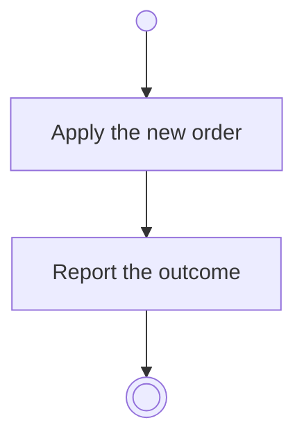

# BP12.04 — Reorder columns

> GENERATED by `bpmn-dsl si-export` — do not edit; the source is the `call` block in the
> `.bpd` (#1182/ADR-068, keyed by call site per ADR-069).
>
> hash: `sha256:088fdc57c8f9398b901903d395bbeca07ac927fb9344b4a225ba3eaf6880494e`

## BP12_ManageBoardColumns — Activity diagram

### Messages

| Where | Message | To | Payload |
|---|---|---|---|
| Reorder columns | The ordering outcome | User | — |
