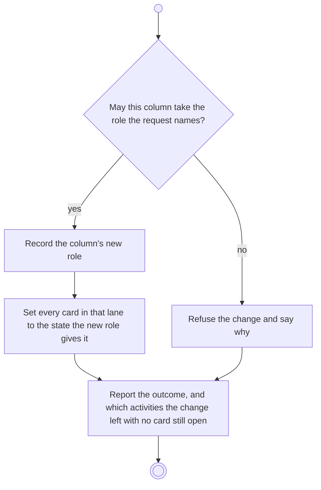

# BP12.05 — Change a column's role

> GENERATED by `bpmn-dsl si-export` — do not edit; the source is the `call` block in the
> `.bpd` (#1182/ADR-068, keyed by call site per ADR-069).
>
> hash: `sha256:1e18cd032c7d9adfffed0e1645441ff282ce3ca399fb5b50199be31557085e8c`

## BP12_ManageBoardColumns — Activity diagram

### Bound rules

| Where | Rule |
|---|---|
| "May this column take the role the request names?" | `BR-60` |
| Record the column's new role | `BR-58` |
| Set every card in that lane to the state the new role gives it | `BR-60` |
| Set every card in that lane to the state the new role gives it | `BR-58` |
| Refuse the change and say why | `BR-59` |
| Report the outcome, and which activities the change left with no card still open | `BR-109` |

### Messages

| Where | Message | To | Payload |
|---|---|---|---|
| Change a column's role | The role-change outcome | User | — |

### Notes

- **Change a column's role**: Within BR-59 and BR-60's limits the consequences are the user's. No history is rewritten: what any span recorded as completed stands (BR-124).
