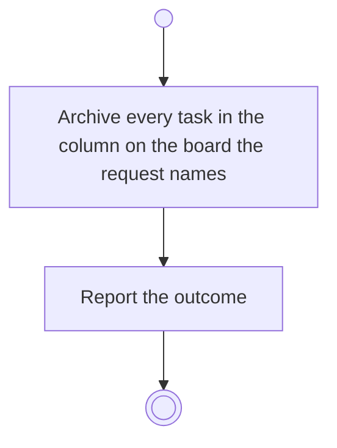

# BP12.06 — Archive a column's tasks

> GENERATED by `bpmn-dsl si-export` — do not edit; the source is the `call` block in the
> `.bpd` (#1182/ADR-068, keyed by call site per ADR-069).
>
> hash: `sha256:5929b5b31a78ba1a440aa2c8114dc55425f6094337fa4a4235611cf733c0a574`

## BP12_ManageBoardColumns — Activity diagram

### Bound rules

| Where | Rule |
|---|---|
| Archive every task in the column on the board the request names | `BR-23` |
| Archive every task in the column on the board the request names | `BR-61` |

### Messages

| Where | Message | To | Payload |
|---|---|---|---|
| Archive a column's tasks | The archiving outcome | User | — |

### Notes

- **Archive a column's tasks**: Archiving is a conscious gesture here as everywhere: no task archives itself. This act reaches the one board the user is on, unlike a change to the template itself.
