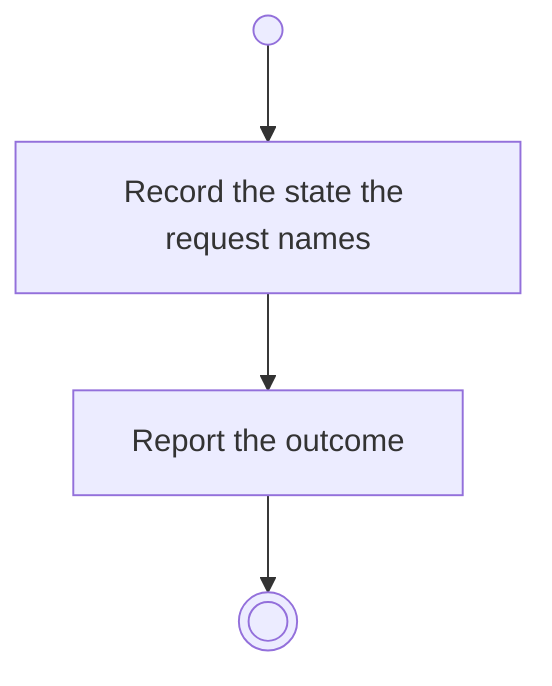

# BP12.10 — Set the activity Done

> GENERATED by `bpmn-dsl si-export` — do not edit; the source is the `call` block in the
> `.bpd` (#1182/ADR-068, keyed by call site per ADR-069).
>
> hash: `sha256:c18675c1d72ee3f2e53a3e903f906cbefa0c6173773ffda6371e69b805edaf4c`

## BP12_ManageBoardColumns — Activity diagram

### Bound rules

| Where | Rule |
|---|---|
| Record the state the request names | `BR-109` |
| Record the state the request names | `BR-127` |

### Messages

| Where | Message | To | Payload |
|---|---|---|---|
| Set the activity Done | The state-change outcome | User | — |

### Notes

- **Set the activity Done**: The Course page owns an activity's state (BP18); this is the completion offer answered from the column settings, as the board answers its own (BP11). A Done activity can be reopened there.
