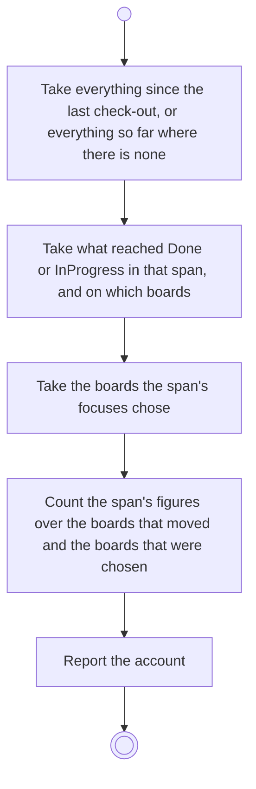

# BP13.01 — Read the account since the last check-out

> GENERATED by `bpmn-dsl si-export` — do not edit; the source is the `call` block in the
> `.bpd` (#1182/ADR-068, keyed by call site per ADR-069).
>
> hash: `sha256:d3c4f03d57823f94b21c572d28e4285eb79f8a1b6ad577e66e4d295af4fd7a97`

## BP13_CheckOutTheWork — Activity diagram

### Bound rules

| Where | Rule |
|---|---|
| Take everything since the last check-out, or everything so far where there is none | `BR-33` |
| Take everything since the last check-out, or everything so far where there is none | `BR-45` |
| Take what reached Done or InProgress in that span, and on which boards | `BR-124` |
| Take the boards the span's focuses chose | `BR-41` |
| Count the span's figures over the boards that moved and the boards that were chosen | `BR-35` |
| Count the span's figures over the boards that moved and the boards that were chosen | `BR-125` |

### Messages

| Where | Message | To | Payload |
|---|---|---|---|
| Read the account since the last check-out | The figures, and what was completed | User | — |
