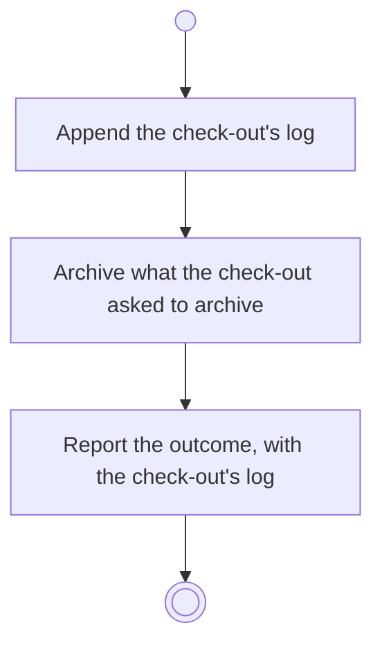

# BP13.03 — Check out the work

> GENERATED by `bpmn-dsl si-export` — do not edit; the source is the `call` block in the
> `.bpd` (#1182/ADR-068, keyed by call site per ADR-069).
>
> hash: `sha256:c91d959d8cd566f8aa8ab719629008fc50855f02a3058f69ca4d6fca5ce27c8f`

## BP13_CheckOutTheWork — Activity diagram

### Bound rules

| Where | Rule |
|---|---|
| Append the check-out's log | `BR-33` |
| Append the check-out's log | `BR-125` |
| Append the check-out's log | `BR-36` |
| Archive what the check-out asked to archive | `BR-23` |
| Archive what the check-out asked to archive | `BR-61` |
| Archive what the check-out asked to archive | `BR-34` |

### Messages

| Where | Message | To | Payload |
|---|---|---|---|
| Check out the work | The check-out outcome | User | — |
